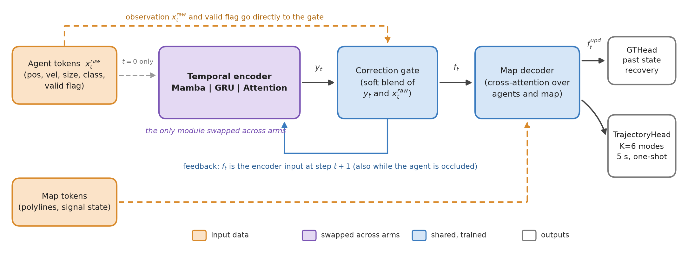
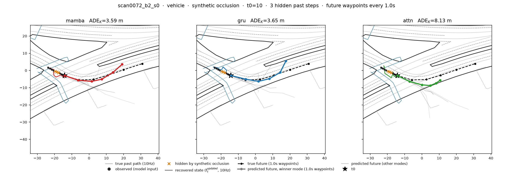
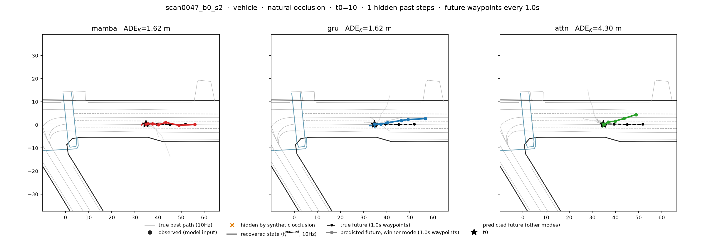
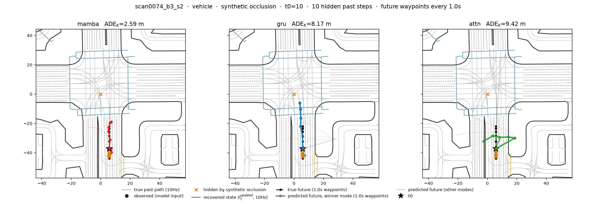

## 문제

자율주행 환경에서는 주변 에이전트가 다른 오브젝트에 가려져 관측이 끊기는 경우가 자주 발생한다. 이때 Transformer 기반 예측 모델은 직전 운동의 관성을 이어가지 못해 궤적이 불연속해질 수 있다.

Mamba는 제어공학의 상태 공간 모델(State Space Model, SSM)에서 기인한 시퀀스 모델이다.

$$
x_t=Ax_{t-1}+Bu_t, \qquad y_t=Cx_t+Du_t
$$

$t=0$부터 관측으로 갱신해 온 내부 상태 $x_t$가 있을 때 가림으로 새 관측이 들어오지 않더라도 상태 전이 $A$만으로 운동을 이어갈 수 있다.

**가설:** Mamba의 Hidden State가 이 $x_t$처럼 위치·속도 같은 물리량을 담는다면 가림 구간에서도 관성을 유지해 GRU나 Transformer보다 정확한 궤적을 예측할 것이다.

이번 연구에서는 같은 구조에서 시간축 인코더만 Mamba, GRU, Attention으로 바꾸어 가림 상황의 예측 성능을 비교한다.

## 접근

Waymo Open Motion Dataset(WOMD) [1]의 에이전트 궤적으로 세 모델을 같은 조건에서 학습하였다. 모델은 에이전트마다 과거 관측을 한 스텝씩 순환 처리하여 현재 상태를 추정하는 시간축 인코더와 이 상태를 주변 에이전트 및 지도와 결합하는 cross-attention 디코더로 구성된다. 세 모델은 시간축 인코더만 Mamba, GRU, Attention으로 다르다. 가림은 관측된 구간의 입력 일부를 지워서 만든 합성 가림과 데이터에 원래 있던 실제 가림으로 나누어 평가하였다. 지표는 예측한 6개 경로 중 정답에 가장 가까운 경로의 평균 위치 오차(minADE₆)이다.

*Figure 1. 비교한 모델의 구조. 시간축 인코더는 상태 추정값 y를 출력하고 보정 게이트는 관측 x와 y를 valid flag에 따라 섞어 보정 feature f를 만든다. f는 다음 스텝의 인코더 입력으로 되먹임되므로 관측이 없는 스텝에서도 인코더는 자신의 추정값으로 상태를 이어간다. 지도 디코더는 f를 주변 에이전트와 지도 토큰에 cross-attention으로 연결하여 f_upd를 만들고 GTHead는 과거 구간의 상태를 TrajectoryHead는 미래 5초의 경로 6개를 출력한다. 그림의 아래 첨자 t는 스텝을 뜻한다. 세 모델은 보라색 시간축 인코더만 다르다.*

## 결과

| 모델 | 전체 minADE₆ ↓ | 가려지지 않음 (1,248) | 합성 가림 (125) | 실제 가림 (45) | 가림 구간 복원 오차 (m) ↓ |
| --- | ---: | ---: | ---: | ---: | ---: |
| GRU | 1.402 | 1.349 | **1.732** | **1.776** | 3.32 |
| Attn | 1.524 | 1.479 | 2.114 | 1.972 | 3.74 |
| Mamba | **1.323** | **1.259** | 1.733 | 1.786 | **3.09** |

minADE₆는 예측 대상 에이전트 1,418개의 평균(m)이며 괄호 안은 에이전트 수이다. 합성 가림은 관측된 구간의 입력 일부를 일부러 지운 에이전트이고 실제 가림은 데이터에서 원래 관측이 끊겼던 에이전트이다. 복원 오차는 지운 스텝의 위치를 모델이 복원한 오차이며 학습 중 검증(시나리오 200개)에서 측정하였다. Attn은 파라미터가 2.28M으로 GRU와 Mamba(약 12M)의 1/5이다.

- Mamba의 전체 minADE₆는 1.323으로 GRU(1.402)보다 5.6% 낮았다. 이 차이는 가려지지 않은 에이전트(1.259 vs 1.349)에서 나온 것이다.
- 가려진 에이전트의 미래 경로 예측에서는 Mamba와 GRU가 차이가 없었다(합성 가림 1.733 vs 1.732, 실제 가림 1.786 vs 1.776). 가려지지 않은 경우 대비 오차 증가량은 오히려 GRU가 작았다(합성 가림 +0.383 vs +0.474).
- 지운 스텝의 위치 복원 오차는 Mamba가 3.09 m로 GRU(3.32 m)보다 약 7% 낮았다. 예측 시점별 오차에서도 Mamba의 이점은 1초 뒤에 18%로 가장 크고 5초 뒤에 2%로 줄었다. 두 결과는 Mamba가 현재 상태를 조금 더 정확히 추정한다는 가설과 같은 방향이다.
- 다만 모델마다 학습을 한 번만 수행하였고 가려진 에이전트가 125개와 45개로 적다. 또한 경로 예측 평가에는 가림 구간에서도 정답 위치를 기준점으로 쓰는 문제가 있어(4.3절 참조) 위 비교는 확정적인 결론이 아니다.

<!-- detail -->

## 0 TL;DR

같은 구조에서 시간축 인코더만 Mamba, GRU, Attention으로 바꾼 세 모델을 Waymo Open Motion Dataset에서 비교하였다. Mamba는 전체 예측 오차와 가림 구간의 위치 복원 오차가 가장 낮았다. 그러나 가려진 에이전트의 미래 경로 예측에서는 GRU와 차이가 없었으므로 가림 구간에서 Mamba가 관성을 더 잘 유지한다는 가설은 경로 예측 지표로 지지되지 않았다. Attention은 모델 크기가 1/5이어서 구조의 차이로 단정하기 어렵다.

## 1 배경

### 1.1 연구 배경

자율주행에서는 주변 에이전트의 미래 경로를 예측하여 ego의 계획에 사용한다. 최근의 예측 모델은 대부분 Transformer 기반이며 에이전트와 지도 사이의 관계를 attention으로 학습한다 [3, 4].

그러나 센서 앞에 다른 오브젝트가 있으면 에이전트의 관측이 끊긴다. WOMD의 학습 데이터에서 중간에 관측이 끊기는 구간을 가진 트랙은 전체의 약 31.6%이고 예측 대상 에이전트는 약 22.5%이다. 끊기는 길이는 중앙값이 0.3초이고 최대 2.2초이다.

Transformer는 입력된 과거 스텝 사이의 관계를 통계적으로 학습한다. 가려진 스텝에는 입력이 없으므로 속도와 방향 같은 물리량을 이어가는 일은 모델이 데이터에서 스스로 배워야 한다. 반면 상태를 한 스텝씩 갱신하는 순환 구조는 새 관측이 없어도 자신의 이전 상태로 운동을 이어가는 형태를 갖는다.

#### 연구 질문

Mamba [2]는 순환 구조 중에서도 상태 전이가 SSM으로 정의되어 있다. 이 구조의 Hidden State가 위치와 속도 같은 물리량을 담아 가림 구간에서 관성을 유지한다면 같은 순환 구조인 GRU [8]나 Attention [9]보다 가려진 에이전트의 경로를 더 정확히 예측해야 한다. 이번 연구는 이 가설을 같은 파이프라인에서 시간축 인코더만 바꾸는 통제 비교로 검증한다.

### 1.2 관련 연구

#### Motion Forecasting with Transformers

MTR [3]과 Wayformer [4]는 에이전트와 지도 토큰 사이의 attention으로 경로를 예측하는 모델이다. VectorNet [5]은 지도를 polyline 단위로 벡터화하여 인코딩하는 방식을 제안하였다. 본 연구도 정적 지도를 VectorNet 방식의 polyline 인코딩으로 표현한다.

#### State Space Models and Mamba

Mamba [2]는 입력에 따라 상태 전이가 달라지는 선택적 SSM이며 계산량이 시퀀스 길이에 선형이다. 궤적 예측에서는 Trajectory Mamba [6]가 인코더-디코더의 self-attention을 SSM으로 바꾸어 Argoverse에서 효율을 높였다. 본 연구는 효율이 아니라 Hidden State가 가림 구간에서 상태를 유지하는지에 초점을 둔다.

#### Occlusion in Motion Forecasting

Scene Informer [7]는 WOMD에서 가려진 영역의 점유 확률과 궤적을 함께 예측하는 Transformer 모델을 제안하였다. 본 연구는 영역 전체가 보이지 않는 경우가 아니라 관측되던 에이전트가 일시적으로 가려졌다가 다시 나타나는 경우에서 시간축 인코더가 상태를 유지하는지를 비교한다.

### 1.3 핵심 아이디어

본 연구에서 '가림'은 에이전트의 입력이 없는 스텝을 말한다. WOMD는 가려진 스텝의 위치를 (0, 0, 0)으로 채워 제공하며 정답 위치가 없다. 그래서 가림을 두 가지로 나눈다.

- 실제 가림: 데이터에서 원래 관측이 끊긴 구간. 정답이 없으므로 미래 경로 예측 지표로만 평가한다.
- 합성 가림: 관측된 스텝의 입력만 지우고 정답은 그대로 두는 가림. 지운 스텝의 위치 복원 오차를 직접 측정할 수 있다.

#### 검증 항목

가설에 대하여 세 가지를 측정한다.

1. 가려진 에이전트의 미래 경로 예측 오차(minADE₆)가 GRU와 Attention보다 낮은가
2. 지운 스텝의 위치 복원 오차가 더 작은가
3. Mamba의 이점이 예측 시점 중 어디에서 나타나는가

#### 기여

- 시간축 인코더만 Mamba, GRU, Attention으로 바꾸고 나머지 구조와 손실과 데이터 파이프라인을 같게 한 통제 비교를 구성하였다.
- 가림을 합성 가림과 실제 가림으로 나누어 경로 예측 오차와 위치 복원 오차를 함께 평가하는 방법을 구성하였다.
- 전체 minADE₆의 이점이 가려지지 않은 에이전트에서 나왔고 가려진 에이전트의 경로 예측에서는 Mamba와 GRU가 차이가 없음을 보였다.
- 평가 과정의 한계를 코드 검토로 찾아 영향 범위와 함께 기록하였다.

## 2 방법론

### 2.1 입력과 출력

- Input
    - WOMD 시나리오 하나는 91스텝 10Hz(9.1초)이다. 에이전트마다 위치(x, y, z), heading, 크기, 속도, 클래스(차량, 보행자, 자전거), 관측 여부(valid flag)를 입력한다.
    - 지도는 차로 중심선, 도로선, 도로 경계, 횡단보도, 정지 표지, 신호등 상태이다.
    - 좌표는 기준 시점(10스텝)의 SDC pose를 원점으로 하는 하나의 좌표계로 변환하며 스텝마다 원점을 옮기지 않는다. 등속 운동이 일정한 위치 변화로 보이게 하기 위해서이다.
    - 시나리오의 에이전트는 최대 300개의 슬롯에 고정 배정한다.
- Output
    - 예측 대상 에이전트마다 미래 5초(50스텝)의 경로 6개와 각 경로의 확률
    - 과거 구간의 매 스텝에서 에이전트의 상태(위치, heading, 크기, 속도, 클래스)

학습에서는 기준 시점을 10스텝부터 80스텝까지 옮겨 가며 한 시나리오에서 여러 번 예측을 감독하며 평가에서는 WOMD의 현재 시점인 10스텝에 고정한다. 평가의 관측 구간은 11스텝(1.1초)이다.

### 2.2 모델

- 시간축 인코더 (스텝마다 에이전트별로 실행)
    - 이전 스텝의 보정 feature f를 입력받아 상태 추정값 y를 출력한다. 첫 스텝은 관측 임베딩으로 시작한다.
    - Mamba, GRU, Attention 중 하나이며 이 모듈만 모델마다 다르다.
- 보정 게이트
    - 관측 x와 y와 valid flag를 입력받아 게이트 값 g를 계산하고 g·x + (1 − g)·y를 MLP로 보정하여 f를 만든다.
    - 관측이 없는 스텝(valid flag가 0)에서는 입력 x가 0이므로 f는 y에 의존한다.
    - f는 다음 스텝의 시간축 인코더로 되먹임한다. 지도 디코더의 출력 f_upd는 되먹임하지 않는다.
- 지도 디코더
    - f를 query로 하고 모든 에이전트의 f와 지도 토큰을 key와 value로 하는 cross-attention 층이다.
    - 정적 지도는 시나리오당 한 번만 인코딩하며 신호등 상태만 스텝마다 더한다.
- Head
    - GTHead는 f와 f_upd에서 에이전트의 상태를 복원한다.
    - TrajectoryHead는 f_upd에서 에이전트 좌표계의 오프셋 6개 경로를 한 번에 출력하고 장면 좌표로 변환한다. 장면 좌표로 바꿀 때의 기준점은 해당 스텝의 에이전트 위치와 방향이다(4.3절 참조).
- 손실
    - 시간축 인코더 출력이 현재 위치와 다음 스텝 위치를 맞추는 보조 항(aux와 next)
    - GTHead의 상태 복원 항(recon). f와 f_upd에 각각 건다.
    - 미래 경로 항(traj). 활성 모드 수를 6개에서 1개로 줄여 가는 Evolving WTA [10]를 사용한다.
    - 모드 확률의 분류 항(mode)

### 2.3 비교군

세 모델은 시간축 인코더 외의 구성 요소(임베딩, 보정 게이트, 디코더 구조, Head, 손실, 데이터)가 같다.

| 모델 | 시간축 인코더 | 인코더 층 수 / 차원 | 디코더 층 수 | 전체 파라미터 | 역할 |
| --- | --- | :---: | :---: | ---: | --- |
| Mamba | Mamba SSM | 6 / 256 | 4 | 12.0M | 검증 대상 |
| GRU | GRU | 6 / 256 | 4 | 11.7M | 순환 구조 일반의 효과와 Mamba 고유의 효과를 구분 |
| Attn | causal self-attention | 4 / 128 | 2 | 2.28M | Transformer 계열 비교군 |

Attn의 크기가 작은 이유는 구현 방식에 있다. Attn은 스텝마다 지금까지의 전체 시퀀스를 다시 계산하므로 활성값 메모리가 시퀀스 길이의 제곱에 비례한다. 32GB에서 학습할 수 있는 최대 크기가 차원 128이었으며 Mamba와 GRU의 약 1/5이다.

### 2.4 실험 설정

> 본 연구는 소속 기관이나 외부 지원 없이 개인적으로 수행한 연구이다. 따라서 GPU 시간과 비용에 제약이 있어 실험의 규모를 작게 설정하였다. 이 연구는 리더보드 성능을 제시하는 것이 아니라 같은 조건에서 시간축 인코더만 바꾼 비교가 핵심이다.

#### Dataset

- 학습: WOMD 학습 shard 1,000개 중 90개(43,894 시나리오)
- 검증: 공식 validation shard 10개(2,976 시나리오) 중 앞쪽 320개 시나리오. 예측 대상 에이전트는 1,418개이다.

합성 가림은 학습과 검증 모두에 적용한다. 에이전트마다 0.5의 확률로 1~2개 구간의 입력을 지우며 구간 길이는 로그정규분포에서 뽑는다(중앙값 약 3스텝 최대 22스텝). 실제 가림의 중앙값(0.3초)에 맞춘 값이다. 검증의 합성 가림은 시나리오 ID로 고정하여 세 모델이 같은 에이전트와 같은 구간을 본다.

#### Metrics

- minADE₆ / minFDE₆ / MissRate@2m: 6개 경로 중 정답과의 평균 위치 오차(ADE)와 최종 위치 오차(FDE)가 가장 작은 경로의 값이다. MissRate@2m은 최종 위치 오차가 2 m 이상인 비율이다. 미래 5초에 대하여 계산하며 WOMD 리더보드의 정의와는 다르다.
- 가림 구분: 기준 시점까지의 과거 관측 구간(0~10스텝)에서 입력이 지워진 에이전트를 합성 가림, 실제 관측이 끊긴 구간이 있고 합성 가림은 없는 에이전트를 실제 가림, 둘 다 없는 에이전트를 가려지지 않음으로 나눈다. 합성 가림이 마지막 스텝까지 이어졌는지는 구분하지 않는다.
- 위치 복원 오차: 합성 가림으로 지운 모든 스텝에서 GTHead(f)가 복원한 위치와 실제 위치의 거리(m)이다. 예측 대상이 아닌 에이전트도 포함하며 학습 중 검증(앞쪽 시나리오 200개)에서 측정한다.
- 시점별 위치 오차: 1~5초 각 시점에서 가장 좋은 경로의 위치 오차이다.
- 기준선: 마지막 관측 속도로 외삽하는 등속 모델(minADE₆ 4.468)을 확인용으로 사용하였다. 세 모델 모두 1.3~1.5로 크게 낮다.

#### Miscellaneous

- 세 모델 모두 AdamW(learning rate 2e-4, weight decay 0.01)와 cosine schedule(warmup 1,000 step)로 20,000 step 학습하였다. batch size는 4이며 약 1.8 epoch에 해당한다.
- 세 모델 모두 처음부터 학습하였다. learning rate schedule이 전체 step 수에 맞추어 감소하므로 이전 실험의 Mamba 체크포인트를 재사용하면 덜 감소한 Mamba와 끝까지 감소한 GRU를 비교하게 되기 때문이다.
- GRU와 Attn은 learning rate {5e-5, 1e-4, 2e-4}를 6,000 step 학습하여 검증 minADE₆로 골랐으며 둘 다 2e-4였다. Mamba는 이전 실험에서 정한 2e-4를 사용하였다.
- 평가에는 검증 minADE₆가 가장 낮은 체크포인트를 사용하였다(Mamba 18,000, GRU 18,000, Attn 14,000 step).
- 모든 모델은 시드 0으로 한 번만 학습하였다.
- RTX 5090 1장에서 모델당 약 5~9시간이 걸렸다.
- 평가 코드의 오류를 결과를 확인한 뒤에 수정하였다. 처음에는 실제 가림 에이전트가 가려지지 않음으로 분류되었으며 수정 후 재학습 없이 같은 체크포인트로 다시 평가하였다. 이 수정으로 결론이 바뀌었다.

## 3 실험 결과

> GPU 시간과 비용의 제약으로 모델마다 한 번만 학습하였으며 시드 간 변동은 측정하지 않았다. 신뢰구간도 계산하지 않았다.

**TABLE 1. 표준 지표 (검증 시나리오 320개 예측 대상 에이전트 1,418개)**

| 모델 | minADE₆ ↓ | minFDE₆ ↓ | MissRate@2m ↓ |
| --- | ---: | ---: | ---: |
| GRU | 1.402 | 3.230 | 0.637 |
| Attn | 1.524 | 3.584 | 0.648 |
| **Mamba** | **1.323** | **3.193** | **0.607** |

#### 가려지지 않은 에이전트 포함 전체

TABLE 1에서 Mamba의 minADE₆는 GRU보다 5.6% 낮았고 Attn보다 13.2% 낮았다. minFDE₆와 MissRate@2m도 같은 순서였다. 이 차이는 가려진 에이전트에서 나온 것이 아니다. 예측 대상의 88%(1,248개)는 가려지지 않은 에이전트이며 TABLE 2에서 Mamba의 이점은 이 구분에서 나타난다.

**TABLE 2. 가림 구분별 minADE₆**

| 모델 | 가려지지 않음 (1,248) | 합성 가림 (125) | Δ 합성 | 실제 가림 (45) | Δ 실제 |
| --- | ---: | ---: | ---: | ---: | ---: |
| GRU | 1.349 | **1.732** | **+0.383** | **1.776** | **+0.427** |
| Attn | 1.479 | 2.114 | +0.635 | 1.972 | +0.493 |
| Mamba | **1.259** | 1.733 | +0.474 | 1.786 | +0.527 |

Δ는 가려진 에이전트의 minADE₆에서 가려지지 않은 에이전트의 minADE₆를 뺀 값이다. 작을수록 가려져도 오차가 덜 증가한다는 뜻이다.

#### 가려진 에이전트의 경로 예측

합성 가림에서 Mamba와 GRU의 minADE₆는 1.733과 1.732이고 실제 가림에서는 1.786과 1.776이다. 차이가 0.01 이하이므로 Mamba와 GRU는 구분되지 않는다. Δ는 두 구분 모두 GRU가 Mamba보다 작았다. 즉 Mamba가 가려지지 않은 에이전트에서 가졌던 이점이 가려진 에이전트에서는 없어졌다.

Attn은 합성 가림에서 2.114로 가장 높았다(Δ +0.635). 실제 가림에서는 1.972로 합성 가림보다 낮았으며 Δ는 Mamba와 비슷하였다. 실제 가림은 에이전트가 45개이므로 이 차이는 우연일 수 있다.

#### 예측 시점별 위치 오차

**TABLE 3. 예측 시점별 위치 오차 (m)**

| 모델 | 1초 | 2초 | 3초 | 4초 | 5초 |
| --- | ---: | ---: | ---: | ---: | ---: |
| GRU | 0.551 | 0.865 | 1.395 | 2.231 | 3.489 |
| Attn | 0.561 | 0.942 | 1.557 | 2.512 | 3.996 |
| **Mamba** | **0.451** | **0.803** | **1.312** | **2.140** | **3.419** |
| Mamba의 GRU 대비 감소 | 18.1% | 7.2% | 5.9% | 4.1% | 2.0% |

Mamba의 이점은 1초 뒤에서 가장 크고 시점이 멀어질수록 줄었다. 짧은 시점의 오차는 현재 위치와 속도를 얼마나 정확히 추정했는지에 크게 좌우되므로 Mamba가 현재 상태를 더 정확히 추정한다는 가설과 같은 방향이다. 다만 이 값은 가려지지 않은 에이전트가 대부분인 평균이며 가림과 무관한 일반적인 이점일 수도 있다.

#### 가림 구간의 상태 복원

**TABLE 4. 합성 가림 스텝의 위치 복원 오차 (m)**

| 모델 | f (지도 결합 전) | f_upd (지도 결합 후) |
| --- | ---: | ---: |
| GRU | 3.32 | 3.45 |
| Attn | 3.74 | 3.96 |
| **Mamba** | **3.09** | **3.26** |

Mamba의 복원 오차는 3.09 m로 GRU보다 약 7% 낮았고 Attn보다 약 17% 낮았다. 세 모델 모두 지도 디코더를 거친 뒤(f_upd)에는 오차가 증가하였다. 이 값은 학습 중 검증(시나리오 200개)에서 측정하였으므로 앞의 표와 평가 에이전트 집합이 다르다. 10,000~20,000 step의 검증 6회 중 5회에서 Mamba의 오차가 GRU보다 낮았으며 마지막 세 번(16,000, 18,000, 20,000 step)은 0.22~0.31 m 낮았다(부록 TABLE A1). 14,000 step에서는 GRU가 낮았다.

#### 정성 결과

*Figure 2. 합성 가림 사례(가려진 과거 스텝 3개). 검은 점선은 실제 미래 경로이고 굵은 선은 각 모델의 최선 경로이다. 주황색 x는 입력에서 지운 스텝이다. minADE는 Mamba 3.59 m, GRU 3.65 m, Attn 8.13 m이다.*

*Figure 3. 실제 가림 사례(가려진 과거 스텝 1개). minADE는 Mamba 1.62 m, GRU 1.62 m, Attn 4.30 m이다.*

두 사례는 Attn과 Mamba의 minADE 차이가 큰 순서로 고른 것이므로 Attn의 오차가 큰 것은 선택 기준의 결과이다. 평균적인 비교는 TABLE 2에 있다. 이 사례에서 확인할 수 있는 것은 Mamba와 GRU가 가림 구간 뒤에도 비슷하게 도로 형상을 따른다는 점이다.

## 4 Conclusion and Discussion

### 4.1 결론

- 같은 구조에서 시간축 인코더만 Mamba, GRU, Attention으로 바꾼 세 모델을 같은 조건에서 학습하여 가림 상황의 예측 성능을 비교하였다.
- Mamba는 전체 minADE₆가 가장 낮았다(GRU 대비 5.6%). 이 이점은 가려지지 않은 에이전트에서 나왔다.
- 가려진 에이전트의 경로 예측에서는 Mamba와 GRU가 차이가 없었다(합성 가림 1.733 vs 1.732, 실제 가림 1.786 vs 1.776). 따라서 가림 구간에서 Mamba가 관성을 더 잘 유지하여 더 정확한 경로를 예측한다는 가설은 경로 예측 지표로 지지되지 않았다.
- 가림 구간의 위치 복원 오차는 Mamba가 가장 작았다(GRU 대비 약 7%). 이 결과는 예측 시점별 이점이 짧은 시점에 집중된 것과 함께 Mamba가 현재 상태를 조금 더 정확히 추정한다는 가설과 같은 방향이다. 그러나 한 번의 학습과 작은 검증 집합에 근거하며 경로 예측으로 이어지는지는 확인하지 못하였다.
- Attn은 모든 지표에서 가장 낮은 성능을 보였으나 모델 크기가 1/5이므로 순환 구조와 Attention 구조의 차이로 단정할 수 없다.
- 4.3절의 한계로 가림 구간의 경로 예측 비교는 가설을 검증하기에 충분하지 않다.

### 4.2 논의

경로 예측에서 Mamba와 GRU의 차이가 없었던 이유로 다음을 생각할 수 있으며 모두 확인하지 않았다.

- 기준점 누출: TrajectoryHead가 가려진 스텝에서도 정답 위치와 방향을 기준점으로 받는다. 기준 시점이 가림 구간 안에 있는 에이전트에서는 현재 위치를 추정할 필요가 없으므로 상태 추정 능력의 차이가 경로 오차에 반영되지 않는다. 해당 에이전트의 수는 집계하지 않았다.
- 효과의 크기: 복원 오차의 차이(0.22 m)가 경로 오차(5초 평균 1.3~1.8 m)에 비하여 작아 경로 예측 지표에서는 드러나지 않았을 수 있다.
- 관측 구간: 평가의 관측 구간이 11스텝(1.1초)뿐이어서 가림 이전에 관성을 추정할 정보가 적다.

정성 사례 중 가림이 긴 두 사례에서는 GRU의 오차가 Mamba보다 컸다(10스텝 사례 8.17 m vs 2.59 m, 8스텝 사례 8.20 m vs 3.10 m, 10스텝 사례는 부록 Figure A1). 그러나 이 사례는 Attn과 Mamba의 차이를 기준으로 고른 두 개뿐이므로 근거로 쓸 수 없다. 가림 길이별로 집계한 평가가 필요하다.

또한 Mamba의 이점이 가려지지 않은 에이전트에서 나온 점은 Mamba가 가림과 무관하게 더 좋은 시퀀스 모델일 가능성과 구분되지 않는다. Hidden State가 실제로 위치와 속도를 담는지는 직접 분석하지 않았다.

### 4.3 한계

- 기준점 누출: TrajectoryHead는 미래 경로를 에이전트 좌표계로 예측한 뒤 장면 좌표로 변환할 때 모델의 추정 위치가 아니라 가려지기 전의 정답 위치와 방향을 기준점으로 쓴다(`model/hybrid.py`). 가려진 스텝에서 기준 시점이 오면 모델은 현재 위치를 공짜로 받는다. 세 모델에 같게 적용되므로 모델 사이의 상대 비교는 유지되지만 가림 구간의 경로 예측 오차는 낙관적이며 상태 추정 능력을 반영하지 못한다. 위치 복원 오차(GTHead)는 이 문제와 무관하다. 수정하려면 재학습이 필요하다.
- 학습 신호: 복원 손실이 합성 가림 스텝뿐 아니라 원래 관측된 모든 스텝에서 계산되어 가림 복원 신호가 희석된다. 입력 속도에서 ego 속도를 빼지 않은 것도 설계 의도와 다르다. 두 가지 모두 세 모델에 같게 적용되며 재학습이 필요하다.
- 통계: 모델마다 시드 하나로 한 번만 학습하였고 가려진 에이전트가 125개와 45개이며 신뢰구간이 없다. 체크포인트 사이에서 Mamba와 GRU의 순위가 바뀐 구간이 있다(부록 TABLE A1).
- 비교의 공정성: Attn은 모델 크기가 1/5이다. 또한 손실 가중치와 학습 방식 같은 공통 설정을 Mamba로 진행한 이전 실험에서 정하였고 GRU와 Attn은 learning rate만 탐색하였으므로 Mamba에 유리할 수 있다.
- 평가 데이터: 체크포인트를 고른 검증 시나리오(200개)가 보고한 평가 시나리오(320개)에 포함되며 별도의 테스트 집합이 없다. 위치 복원 오차에는 등속 외삽 같은 기준선이 없다.
- 범위: WOMD 한 데이터셋에서 관측 1.1초와 예측 5초로 평가하였으며 리더보드 수치와 비교할 수 없다. 미래 5초를 10Hz로 직접 회귀하며 인접 스텝의 부드러움을 강제하는 항이 없어 경로가 미세하게 흔들린다.

### 4.4 향후 과제

- 기준점을 GTHead가 복원한 위치로 바꾸고 복원 손실을 합성 가림 스텝으로 한정하고 ego 속도를 제거하여 재학습한다. 시드를 여러 개 사용한다.
- 가림 길이별로 평가하고 기준 시점이 가림 구간에 포함되는 에이전트를 따로 평가한다. 관측 구간의 길이도 바꾸어 본다.
- Hidden State에 선형 probe를 붙여 위치와 속도를 읽을 수 있는지 직접 확인한다.
- Attn을 KV cache 방식으로 구현하여 같은 크기에서 비교할 수 있는지 검토한다.
- 미래 경로를 1초 간격 waypoint처럼 낮은 해상도로 출력하는 구조를 시험한다.

## 5 배운 점

전체 minADE₆만 보았을 때는 Mamba가 가장 좋아 가설이 지지되는 것처럼 보였다. 가림 여부로 나누어 보자 이점이 가려지지 않은 에이전트에서 나온 것이었다. 처음 평가 코드에는 실제 가림 에이전트를 가려지지 않음으로 분류하는 오류가 있었고 이를 수정하자 결론이 바뀌었다. 집계 지표 하나로 결론을 내리지 않고 분할하여 확인해야 한다는 것을 배웠다.

기준점 누출은 학습이 약 24시간 진행된 뒤 전체 코드를 검토하다가 발견하였다. 학습을 시작하기 전에 평가에 쓰이는 입력 경로에 정답이 섞이지 않는지 점검해야 했다. 이후에는 문제가 세 모델에 같게 적용되는지 구분하여 상대 비교가 유효한 범위와 절대 수치가 영향을 받는 범위를 나누어 기록하였다.

비교 실험에서는 구조 외의 조건이 같은지가 결과의 신뢰를 정한다. 이전 실험의 Mamba 체크포인트를 재사용하면 약 5시간을 줄일 수 있었으나 learning rate schedule이 달라 공정한 비교가 되지 않으므로 세 모델을 처음부터 같은 step 수로 학습하였다.

Occlusion 구간에서 Mamba가 관성을 더 잘 유지할 것이라 가정하였으나 occlusion 객체의 경로 예측 성능은 GRU와 차이가 없었다. 가설과 다른 결과도 같은 조건에서 측정하여 그대로 보고하는 것이 통제 비교의 목적이라는 것을 확인하였다.

## References

1. S. Ettinger et al., "Large Scale Interactive Motion Forecasting for Autonomous Driving: The Waymo Open Motion Dataset," ICCV, 2021. arXiv:2104.10133.
2. A. Gu and T. Dao, "Mamba: Linear-Time Sequence Modeling with Selective State Spaces," arXiv:2312.00752, 2023.
3. S. Shi et al., "Motion Transformer with Global Intention Localization and Local Movement Refinement," NeurIPS, 2022.
4. N. Nayakanti et al., "Wayformer: Motion Forecasting via Simple & Efficient Attention Networks," ICRA, 2023.
5. J. Gao et al., "VectorNet: Encoding HD Maps and Agent Dynamics from Vectorized Representation," CVPR, 2020.
6. Y. Huang, Y. Cheng, K. Wang, "Trajectory Mamba: Efficient Attention-Mamba Forecasting Model Based on Selective SSM," CVPR, 2025. arXiv:2503.10898.
7. B. Lange, J. Li, M. J. Kochenderfer, "Scene Informer: Anchor-based Occlusion Inference and Trajectory Prediction in Partially Observable Environments," ICRA, 2024. arXiv:2309.13893.
8. K. Cho et al., "Learning Phrase Representations using RNN Encoder–Decoder for Statistical Machine Translation," EMNLP, 2014.
9. A. Vaswani et al., "Attention Is All You Need," NeurIPS, 2017.
10. O. Makansi et al., "Overcoming Limitations of Mixture Density Networks: A Sampling and Fitting Framework for Multimodal Future Prediction," CVPR, 2019.

## 부록

**TABLE A1. 체크포인트별 검증 결과 (학습 중 검증 시나리오 200개)**

| step | minADE₆ GRU | minADE₆ Attn | minADE₆ Mamba | 복원 오차 GRU | 복원 오차 Attn | 복원 오차 Mamba |
| --- | ---: | ---: | ---: | ---: | ---: | ---: |
| 10,000 | 2.261 | 1.661 | 1.750 | 3.98 | 4.52 | 3.62 |
| 12,000 | 1.526 | 1.627 | 1.564 | 3.91 | 4.02 | 3.43 |
| 14,000 | 1.436 | 1.487 | 1.468 | 3.62 | 3.74 | 3.77 |
| 16,000 | 1.412 | 1.496 | 1.405 | 3.45 | 4.25 | 3.15 |
| 18,000 | 1.373 | 1.532 | 1.318 | 3.32 | 4.35 | 3.09 |
| 20,000 | 1.395 | 1.504 | 1.328 | 3.28 | 4.07 | 3.05 |

복원 오차는 f 기준(m)이다. 본문의 표는 검증 minADE₆가 가장 낮은 체크포인트(Mamba 18,000, GRU 18,000, Attn 14,000 step)의 값이며 minADE₆는 시나리오 320개로 다시 평가한 값이라 이 표와 조금 다르다.

*Figure A1. 합성 가림 사례 중 가림이 가장 긴 경우(10스텝으로 관측 구간 11스텝 중 거의 전부가 가려짐). minADE는 Mamba 2.59 m, GRU 8.17 m, Attn 9.42 m이다. 이 길이는 실제 가림 분포(중앙값 0.3초)보다 훨씬 길어 대표 사례가 아니라 극단적인 사례이며 Attn과 Mamba의 차이가 큰 순서로 고른 것이다.*

수치의 출처는 저장소의 `ABLATION.md`와 `runs/ablation_report.txt`이다.
