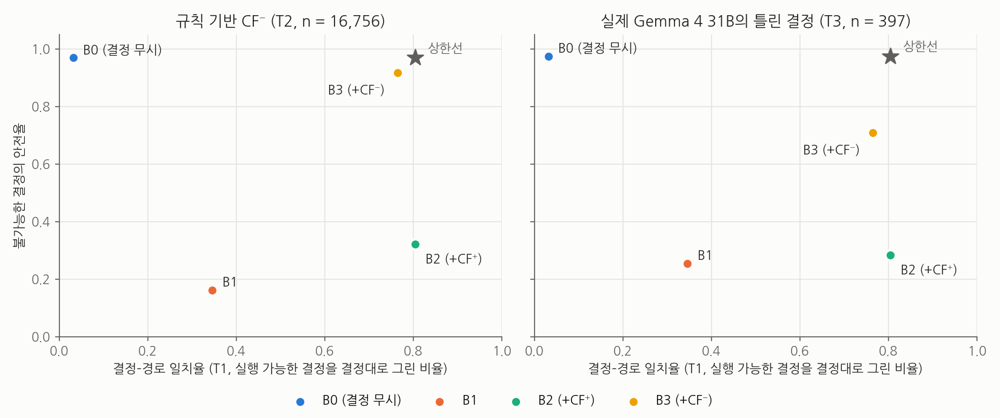
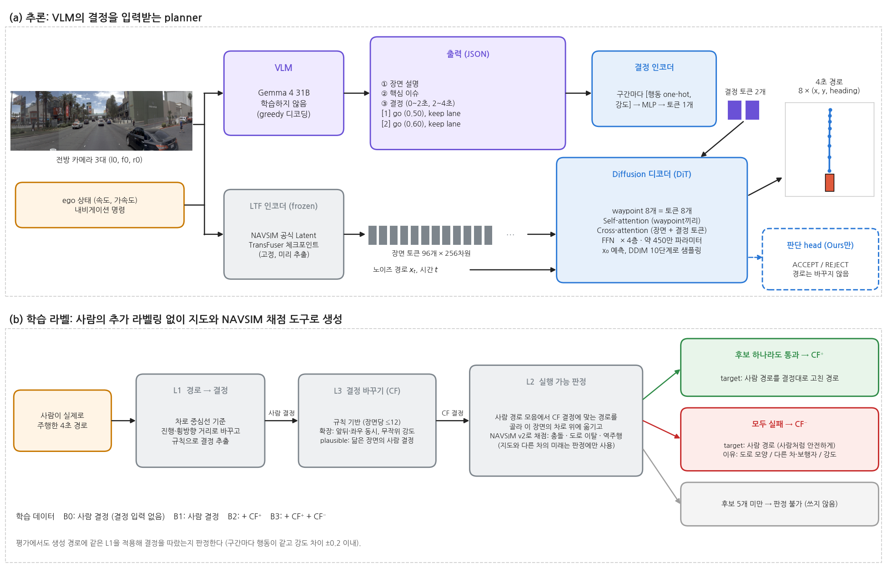
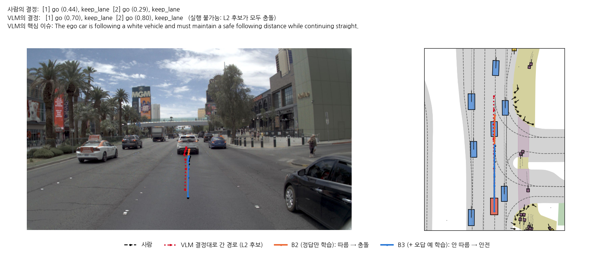
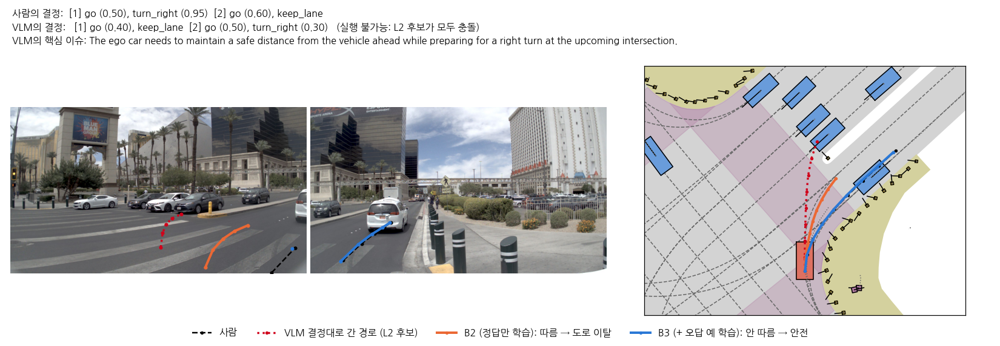
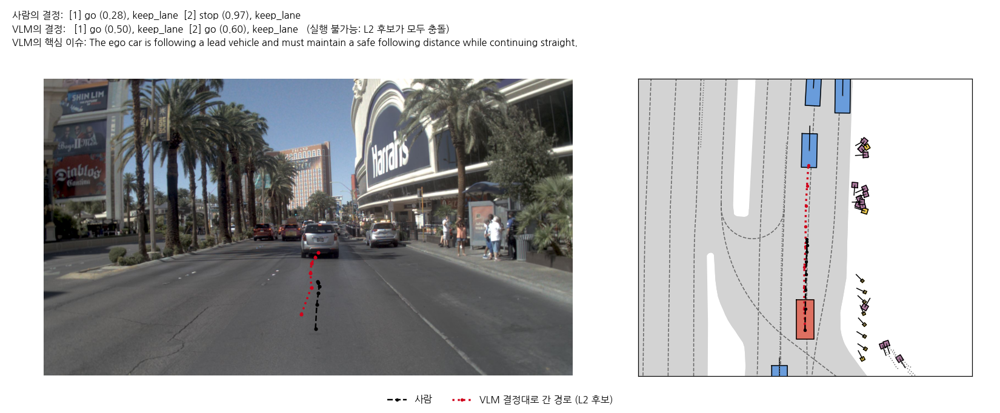

**YESMAN**: **Y**our **E**go-planner **S**houldn't **M**indlessly **A**ccept **N**onsense

## 문제

VLM이 주행 결정을 내리고 planner가 그 결정을 입력받아 경로를 생성하는 구조가 늘고 있다. 그러나 VLM도 틀릴 수 있으며, 앞차가 가까운데 속도를 높이라고 하거나 차로가 없는 방향으로 회전하라고 지시할 수 있다. 이 연구는 실행 가능한 결정만 학습한 planner가 이러한 결정을 입력받았을 때 안전한 경로를 생성하지 못한다는 것을 보이고, 실행할 수 없는 결정의 예를 함께 학습시키면 planner가 안전해지는지 검증한다.

## 접근

같은 장면에 대해 사람의 결정을 의도적으로 바꾼 counterfactual decision을 만들고, NAVSIM 채점 도구로 실행 가능 여부를 자동으로 판정했다. 실행 가능한 결정(CF⁺)만 학습한 planner와 실행할 수 없는 결정(CF⁻)까지 함께 학습한 planner를, 학습에 사용하지 않은 실제 VLM(Gemma 4 31B)의 결정으로 평가했다.

*Figure 1. 결정–경로 일치율(가로)과 실제 VLM 오답에 대한 안전율(세로). B0~B3, 시드 2개 평균.*

## 결과

| 모델 | 결정–경로 일치율 | 실제 VLM의 불가능한 결정을 그대로 따른 비율 | 안전율 | 주행 점수 |
| --- | ---: | ---: | ---: | ---: |
| 정답만 학습 (B2) | **80.5%** | 50.8% | 28.5% | 0.939 |
| **+ 오답 예 학습 (B3)** | 76.5% | **23.9%** | **70.9%** | 0.939 |

- 정답만 학습한 planner는 실제 VLM이 출력한 실행 불가능한 결정의 절반을 그대로 따랐으며, 따르지 않은 경우에도 안전율이 41.9%에 그쳐 전체 안전율은 28.5%였다.
- 오답 예(CF⁻)를 함께 학습시키면 결정을 따르는 능력과 주행 점수를 대부분 유지하면서 안전율이 70.9%로 상승했다.
- 실제 VLM 오답의 절반 이상은 거리와 속도를 판단해야 하는 결정이었으며, 규칙으로 생성한 오답과는 구성이 달랐다.

<!-- detail -->

## 0 TL;DR

VLM의 결정을 입력받는 planner는 실행 가능한 결정만 학습해서는 VLM의 틀린 결정에서 안전하지 않으며, 실행할 수 없는 결정의 예를 함께 학습해야 한다.

## 1 배경

### 1.1 연구 배경

Vision-Language Model(VLM)은 real-world의 일반적인 지식을 포함하고 있기 때문에 End-to-End(E2E) 대비 long-tail 상황에서의 일반화를 기대할 수 있어 자율주행 분야에서도 많은 연구가 진행되고 있다. 최근에는 VLM이 상황 설명과 high-level decision(이하 결정)을 출력하고, 별도의 planner가 그 결정과 영상 특징을 함께 입력받아 low-level trajectory(이하 경로)를 생성하는 hybrid 구조가 연구되고 있다 [1, 3, 4].

그러나 VLM도 상황을 잘못 판단하거나 결정을 잘못 내릴 수 있다. 잘못된 결정을 입력받은 planner는 다음 두 가지 중 하나로 동작한다.

1. 잘못된 결정을 그대로 따라서 도로를 벗어나거나 다른 오브젝트와 충돌한다.
2. 영상을 참고하여 결정과 다른 안전한 경로를 생성한다.

#### 문제 1

기존 hybrid 구조 연구는 planner가 VLM의 결정을 더 충실하게 따르도록 만드는 방향으로 진행되고 있다 [1]. 반면 VLM 자신이 출력한 틀린 결정이 입력되었을 때 planner가 위 두 가지 중 어떻게 동작하는지는 평가되지 않았다(내비게이션처럼 외부에서 주어진 잘못된 지시에 대한 연구는 1.2절에서 다룬다). 모방학습(Imitation Learning, IL)에서 planner의 학습 데이터는 사람이 실제로 주행한 경로이므로 planner는 실행 가능한 결정과 그에 맞는 경로만 학습하게 되며, 이러한 planner가 틀린 결정을 입력받았을 때의 행동은 충분히 측정되지 않았다 **(문제 1)**.

#### 문제 2

잘못된 지시를 학습 데이터에 포함한 선행 연구가 있으나 [2], 그 효과를 정량적으로 측정하지 않았다. 또한 잘못된 지시에 대한 강건성을 다룬 연구들은 사람이 설계하거나 규칙으로 생성한 지시를 사용했으며 [5, 6], 실제 VLM이 출력한 틀린 결정으로 평가하지 않았다 **(문제 2)**.

### 1.2 관련 연구

#### VLM for Autonomous Driving

Senna [3]와 DiffVLA [4]는 VLM이 결정을 내리고 별도의 planner가 경로를 생성하는 구조를 제안했으며, 특히 DiffVLA는 VLM의 결정을 diffusion planner에 입력한다. Senna-2 [1]는 VLM의 결정과 planner의 경로 사이의 일관성을 높이기 위해 세 단계의 학습을 제안했으며, 마지막 단계에서는 3DGS 환경을 통해 closed-loop에서 강화학습(RL)으로 안전성과 효율을 보강했다. 이처럼 기존 연구는 planner가 VLM의 결정을 충실히 따르도록 하는 데 초점을 두었다. 본 연구는 planner 학습에서 기본이 되는 모방학습에 한정하여, 틀린 결정이 입력되었을 때 planner가 어떻게 행동하는지 평가한다.

#### Robustness to Wrong Instructions

Carton et al. [5]은 CARLA의 교차로에서 잘못된 주행 명령을 주었을 때 주행 agent의 위험 행동(충돌, 도로 이탈, 교차로 안에서의 정지)을 측정했다. 제안한 강화학습 agent뿐 아니라 비교 대상인 모방학습 agent(LBC)도 60회 중 23회 위험 행동을 보였다. ICR-Drive [6]는 언어 지시를 바꾸거나 오도하는 지시를 주었을 때 LMDrive [2]와 BEVDriver의 주행 성능이 크게 하락함을 보였다. 그러나 이들 연구는 측정에 그쳤으며, 이를 학습으로 개선하는 방법은 다루지 않았다.

#### Learning from Negative Examples

ChauffeurNet [7]은 사람의 주행 경로를 교란한 데이터와 충돌에 벌점을 주는 손실을 추가하여, 정답 주행만 모방하는 학습의 한계를 보완했다. LMDrive [2]는 교통 법규를 위반하는 잘못된 지시를 학습 데이터에 추가하여 모델이 이를 거부하도록 학습시켰으나, 그 효과를 정량적으로 측정하지 않았으며 도로 모양에 따른 오답만 다루었다. SafeDriveVLA [8]는 내비게이션 지시와 장면이 충돌하는 경우 world model로 지시를 따른 결과를 예측하여 위험한 지시를 무시하는 방법을 제안했다.

위 연구들은 모두 내비게이션이나 사람처럼 외부에서 주어진 지시를 다루었으며, 잘못된 지시도 사람이 설계하거나 규칙으로 생성했다. 반면 본 연구는 hybrid 구조에서 상위 VLM 자신이 출력한 틀린 결정을 다루며, 정답만 학습한 planner의 한계와 오답 예 학습의 효과를 같은 구조에서 통제 비교하고 실제 VLM의 오답으로 평가한다.

### 1.3 핵심 아이디어

본 연구에서 틀린 결정이란 실행할 수 없는 결정을 말한다. 즉, 그 결정에 맞는 후보 경로(다른 장면에서 사람이 주행한 경로를 옮긴 것, 2.1절의 L2) 중 어느 것도 NAVSIM 채점에서 충돌, 도로 이탈, 역주행을 모두 피하지 못하는 결정이다. 이 판정은 보수적이어서 실제로는 실행 가능한 결정이 일부 포함된다(5.1절). 사람의 결정과 다르지만 실행 가능한 결정은 본 연구의 대상이 아니다.

#### 주장 1

**(문제 1)**에 대하여, 실행 가능한 결정만 학습한 planner는 VLM의 실행할 수 없는 결정을 입력받았을 때 안전한 경로를 생성하지 못한다. 결정을 더 잘 따르도록 학습시켜도 이 한계는 해소되지 않는다.

#### 주장 2

실행할 수 없는 결정과 그 장면에서의 안전한 경로를 묶은 counterfactual data(CF⁻)를 함께 학습시키면, 모델 구조를 변경하지 않고도 실행할 수 없는 결정에 대한 안전율이 상승한다. 이때 실행 가능한 결정을 따르는 능력과 주행 점수는 대부분 유지된다.

#### 주장 3

**(문제 2)**에 대하여, 규칙으로 생성한 오답과 실제 VLM의 오답은 구성이 다르다. 따라서 규칙으로 생성한 오답만으로 평가하면 CF⁻를 학습한 planner의 안전율이 실제 VLM 오답에서보다 높게 측정되며, 학습에 사용하는 CF⁻도 실제 VLM 오답과 같은 유형의 결정 변화를 포함해야 한다.

## 2 조건

### 2.1 결정과 라벨

*Figure 2. 전체 구조. (a) VLM이 출력한 결정을 결정 인코더로 토큰화하고, 고정된 LTF 인코더의 장면 토큰과 함께 DiT 디코더가 cross-attention으로 참조하여 4초 경로를 생성한다. (b) 사람 경로에서 L1으로 결정을 추출하고, 결정을 바꾼 CF를 L2로 판정하여 CF⁺와 CF⁻로 나눈다.*

#### 결정 형식

4초 경로를 0~2초, 2~4초의 두 구간으로 나누고, 구간마다 종방향 행동과 횡방향 행동, 그리고 각각의 강도(0~1)를 결정으로 정의한다.

- 종방향 행동: go, stop
- 횡방향 행동: keep lane, offset(좌/우), 차로 변경(좌/우), 회전(좌/우)

| 행동 | 강도의 정의 |
| --- | --- |
| go | 구간 끝 속도 ÷ 10.5 m/s |
| stop | 구간 동안의 속도 감소량 ÷ 2.8 m/s |
| 회전 | 구간 동안의 heading 변화 ÷ 45° |
| offset | 횡방향 이동 거리 ÷ 1.7 m |
| 차로 변경 | 최대 횡방향 속도 ÷ 2.0 m/s |

예를 들어 "[1] go (0.50), keep lane [2] go (0.60), keep lane"은 차로를 유지하면서 2초 뒤 약 5.3 m/s, 4초 뒤 약 6.3 m/s로 주행하라는 결정이다.

#### 라벨 생성

라벨은 세 단계로 생성하며, 모두 사람의 추가 라벨링 없이 지도와 NAVSIM 채점 도구로 자동 생성한다.

- L1 (경로 → 결정)
    - 지도의 차로 중심선을 기준으로 경로를 진행 거리와 횡방향 거리로 변환하고, 규칙에 따라 결정을 추출한다.
    - 학습 라벨을 생성할 때와 모델이 결정을 따랐는지 평가할 때 같은 함수를 사용한다.
- L2 (실행 가능 판정)
    - navtrain의 사람 경로 모음에서 해당 결정에 맞는 경로를 선택하여 판정할 장면의 차로 위에 배치한다.
    - NAVSIM v2 채점 도구로 충돌, 도로 이탈, 역주행을 확인한다.
    - 세 항목을 모두 통과하는 후보가 하나라도 있으면 실행 가능, 하나도 없으면 실행 불가능, 후보가 5개 미만이면 판정 불가로 분류한다.
    - 지도와 다른 차량의 미래 움직임은 판정에만 사용하며 모델 입력에는 포함하지 않는다.
- L3 (counterfactual decision, CF)
    - 사람의 원래 결정을 의도적으로 바꾼 결정을 L2로 판정하여, 실행 가능하면 CF⁺, 실행 불가능하면 CF⁻로 분류한다.
    - CF⁻는 실행할 수 없는 이유에 따라 도로 모양 / 다른 차·보행자 / 강도 기준으로 나눈다. 강도 기준은 행동의 종류는 실행 가능하지만 강도가 지나쳐 실행할 수 없는 결정을 말한다(e.g. 앞차가 있는데 사람보다 높은 속도를 지시).

CF는 세 가지 방식으로 생성한다.

| CF 생성 방식 | 내용 |
| --- | --- |
| 규칙 기반 CF | 정해진 목록에 따라 한 번에 한 가지 요소만 바꾼다(횡방향 행동 변경, 속도 ±0.3, 정지 등). 장면마다 최대 12개 |
| 확장 CF | 종방향과 횡방향을 동시에 바꾸거나 강도를 무작위로 설정한다. 장면마다 4개 |
| plausible CF | VLM을 사용하지 않고, 그럴듯하지만 이 장면에는 맞지 않을 수 있는 사람의 결정을 현재 장면에 적용한다. (1) 내비게이션 명령이 같고 속도 차이가 2 m/s 이내인 다른 로그의 장면 중 인코더 특징이 가장 유사한 10개 장면의 결정, (2) 같은 로그에서 약 1.5초 전 장면의 사람 결정을 사용한다 |

학습 목표(target) 경로는 샘플의 종류에 따라 다르다. 사람의 원래 결정과 CF⁻에는 그 장면에서 사람이 실제로 주행한 경로를 지정한다. 즉, CF⁻는 "이 결정을 입력받더라도 사람처럼 안전하게 주행하라"는 예이다. CF⁺에는 사람의 경로에서 결정이 변경을 지시한 부분(속도 또는 횡방향 위치)만 수정한 경로를 지정한다.

### 2.2 모델

모든 planner는 같은 고정 인코더와 같은 diffusion 디코더를 사용한다. 모델 간의 차이는 결정 입력 여부와 학습 데이터뿐이다.

#### Planner

- Input
    - 전방 카메라 3대의 이미지, 차량 상태, 내비게이션 명령
    - VLM의 결정 (2구간)

- Do
    - encoder (frozen)
        - NAVSIM 공식 Latent TransFuser(LTF) 체크포인트를 고정하여 사용한다.
        - 장면 토큰 96개(256차원)를 한 번 추출하여 저장한다.
    - decision encoder
        - 구간마다 행동의 종류(one-hot)와 강도를 MLP에 입력하여 토큰 하나로 변환한다.
    - diffusion decoder (DiT)
        - waypoint 8개(4초, 0.5초 간격)를 토큰으로 하는 4층 Transformer 디코더이며 파라미터는 450만 개이다.
        - self-attention으로 waypoint 간의 관계를, cross-attention으로 장면 토큰과 결정 토큰을 참조한다.
        - x0 예측 방식으로 학습하고 DDIM 10단계로 샘플링한다.
        - RTX 5090에서 장면 하나의 경로 생성(DDIM 10단계)에 약 7.5 ms, 인코더에 약 5.1 ms가 걸린다.

- Output
    - 4초 경로 (waypoint 8개, 각각 x, y, heading)

planner로 diffusion 기반 디코더를 사용한 이유는 다음과 같다. 결정과 장면이 충돌하는 경우, 결정을 따르는 경로와 장면에 맞는 경로가 모두 학습 데이터에 존재하게 된다. 회귀 방식은 이 두 경로의 평균에 가까운, 어느 쪽에도 맞지 않는 경로를 출력할 수 있는 반면, diffusion은 경로의 분포에서 표본을 생성하므로 이 문제를 피할 수 있다 [9]. 또한 VLM의 결정을 diffusion planner에 입력하는 구조는 DiffVLA [4]에서 사용되었다.

#### 비교군

각 구성 요소의 기여를 분리하기 위해 구성 요소를 하나씩 추가하는 방식으로 비교군을 구성했다.

| 모델 | 결정 입력 | 학습 데이터 | 역할 |
| --- | :---: | --- | --- |
| B0 | ✕ | 사람 결정 | 결정을 사용하지 않는 기준 |
| B1 | ○ | 사람 결정 | 결정 입력의 효과 |
| B2 | ○ | + CF⁺ | 실행 가능한 결정만 학습 (정답만 학습) |
| **B3** | ○ | + CF⁺ + CF⁻ | **실행할 수 없는 결정까지 학습** |

추가 실험으로 B3에 명시적인 판단(ACCEPT / REJECT)을 출력하는 head를 더한 모델(Ours)을 비교했다.

### 2.3 실험 설정

#### Dataset

NAVSIM navtrain의 카메라 데이터 32조각을 학습, 검증, 테스트 용도로 로그가 겹치지 않도록 나누었다.

- 학습 + 검증: 72,806장면 (검증은 그중 로그 88개)
- 테스트: 18,880장면 (학습과 검증에 사용하지 않은 4조각)
- NAVSIM의 공식 평가 split인 navtest는 초기 실험에서 결과를 확인하며 설계를 수정하는 데 사용했기 때문에 개발 세트로 분류하고, 주 결과에는 사용하지 않았다.

학습 데이터의 구성은 아래와 같다.

| 샘플 | 개수 | target 경로 |
| --- | ---: | --- |
| 사람의 원래 결정 | 62,972 | 사람의 경로 |
| CF⁺ | 428,639 | 결정대로 수정한 경로 |
| CF⁻ | 94,818 | 사람의 경로 |

테스트 세트는 입력하는 결정의 종류에 따라 네 가지로 구성했다.

| 세트 | 입력하는 결정 | 규모 |
| --- | --- | ---: |
| T0 | 사람의 원래 결정 | 18,219 |
| T1 | 규칙 기반 CF⁺ | 75,767 |
| T2 | 규칙 기반 CF⁻ (원인이 카메라 시야 밖인 결정 제외) | 16,756 |
| T3 | 실제 VLM(Gemma 4 31B)의 결정 중 실행 불가능한 결정 | 397 |

T3는 테스트 18,219장면에 대해 Gemma 4 31B가 출력한 결정을 L2로 판정하여 구성했다. T2는 학습에서와 같이 원인(다른 차·보행자)이 카메라 시야 밖에 있는 결정을 제외했으나, T3는 사전 등록한 대로 실행 불가능한 결정 전체를 사용했다. T3에서 이러한 결정은 24개이며, 이를 제외해도 결과는 같다(B2 28.6%, B3 73.1%). VLM에는 planner와 같은 전방 카메라 3대의 이미지, 차량의 속도와 가속도, 내비게이션 명령을 입력했으며, 장면 설명, 핵심 이슈, 결정의 세 단계를 JSON 형식으로 출력하도록 했다. 모든 planner는 실제 VLM의 결정을 학습에 사용하지 않았으므로, T3는 학습에 사용하지 않은 VLM의 오답에 대한 일반화 성능을 나타낸다.

#### Metrics

- 결정–경로 일치율: 실행 가능한 결정(T1)을 입력받았을 때 결정대로 경로를 생성한 비율. 생성한 경로에서 L1으로 추출한 결정이 입력한 결정과 구간마다 행동의 종류가 같고 강도 차이가 ±0.2 이내이면 일치로 판정한다.
- 맹목적 추종 비율: 실행할 수 없는 결정을 입력받았을 때 결정대로 경로를 생성한 비율
- 불가능한 결정의 안전율(이하 안전율): 실행할 수 없는 결정을 입력받았을 때 생성한 경로가 충돌, 도로 이탈, 역주행을 모두 피한 비율. 결정을 따랐는지와 관계없이 경로의 결과만 판정한다.
- 주행 점수: 사람의 결정(T0)을 입력했을 때 NAVSIM v2 EPDMS의 채점 항목으로 장면마다 계산한 점수의 평균. 연속된 두 프레임이 필요한 확장 편안함(EC) 항목은 제외했으므로, 리더보드의 EPDMS와 직접 비교할 수 없다.

#### 학습 및 평가 절차

- 모든 모델은 AdamW(learning rate 2e-4, batch size 256)로 80,000 step 학습했다.
- 모든 모델은 시드 0과 1로 학습했으며, 결과는 두 시드의 평균이다.
- 학습 step 수와 CF의 가중치는 검증 세트에서 선택했다.
- 테스트 세트는 체크섬으로 고정한 뒤, 모든 학습과 선택이 끝난 후 한 번만 평가했다. 모델 선택 규칙과 비교의 성공 기준은 결과를 확인하기 전에 문서로 고정했다(사전 등록).
- 테스트 결과를 확인한 뒤에 수행한 분석은 본문에 사후 분석으로 표기했다.

본 연구는 기관에 소속되지 않은 개인 연구로, computing resource와 비용에 상당한 제약이 있었다. 이에 따라 인코더는 고정하고 작은 디코더만 학습했으며, 시드는 2개로 제한했다.

## 3 실험 결과

**TABLE 1. 전체 결과 (테스트 세트, 시드 2개 평균)**

| 모델 | 결정–경로 일치율 (T1) | 안전율: 규칙 기반 CF⁻ (T2) | 안전율: 실제 VLM 오답 (T3) | 주행 점수 (T0) |
| --- | ---: | ---: | ---: | ---: |
| B0 | 3.1% | 96.9% | **97.5%** | 0.938 |
| B1 | 34.6% | 16.2% | 25.4% | 0.946 |
| B2 | **80.5%** | 32.3% | 28.5% | 0.939 |
| **B3** | 76.5% | 91.8% | 70.9% | 0.939 |

두 시드의 차이는 B1의 T2 안전율(5.3%p)을 제외하면 모두 2%p 이내이다(시드별 값은 부록 TABLE A1).

#### 주장 1에 대한 근거

주장 1을 뒷받침하는 근거는 TABLE 1, 2, 3에서 찾을 수 있다.

TABLE 1의 핵심 비교 대상은 'B0 vs B1', 'B1 vs B2'이다.

- B0 vs B1
    - 결정을 입력받지 않는 B0의 안전율(T3)은 97.5%인 반면, 사람의 결정만 학습한 B1은 25.4%이다(−72.0%p [95% 구간 −76.3, −67.8]). 두 모델의 차이는 결정 입력 여부뿐이므로, 이 차이는 결정을 입력으로 받는 것 자체에서 발생하는 위험을 나타낸다.
- B1 vs B2
    - CF⁺를 추가로 학습한 B2는 결정–경로 일치율이 34.6%에서 80.5%로 상승했으나, 안전율(T3)은 25.4%에서 28.5%로 거의 변하지 않았다(+3.0%p [95% 구간 −1.4, +7.4]). 즉, 실행 가능한 결정을 더 잘 따르도록 학습시키는 것만으로는 실행할 수 없는 결정에 대한 안전이 확보되지 않는다.

**TABLE 2. 실제 VLM의 실행 불가능한 결정(T3)에 대한 planner의 행동 (사후 분석). 괄호 안은 해당 경우에 생성한 경로의 안전율**

| 모델 | 결정을 그대로 따름 (맹목적 추종) | 결정을 따르지 않음 | 전체 안전율 |
| --- | ---: | ---: | ---: |
| B1 | 66.4% (8.2%) | 33.6% (59.6%) | 25.4% |
| B2 | 50.8% (15.4%) | 49.2% (41.9%) | 28.5% |
| B3 | **23.9%** (25.8%) | 76.1% (**85.1%**) | **70.9%** |

TABLE 2는 T3의 결정을 planner가 결정을 따랐는지에 따라 나눈 결과이다. B2는 실제 VLM의 실행 불가능한 결정 중 50.8%를 그대로 따랐으며, 이 경우 안전율은 15.4%이다. 결정을 따르지 않은 나머지 49.2%에서도 안전율은 41.9%에 그쳤다. 즉, B2가 결정을 따르지 않았다는 것이 안전한 경로를 생성했다는 것을 의미하지 않는다.

B2가 결정을 따르지 않았는데 사고가 난 경로는 대부분 결정을 절반 정도만 실행한 경로였다(사후 분석). 속도를 사람보다 높이라는 결정(4초 뒤 속도가 사람보다 1.5 m/s 이상 빠른 233개)에서 4초 뒤 속도의 위치 φ = (경로 − 사람) / (결정 − 사람)을 계산했다. φ가 0이면 사람처럼, 1이면 결정대로 주행한 것이다. 이 결정들에서 B2가 결정을 따르지 않고 사고를 낸 경로 144개(두 시드 합) 중 81%는 φ가 0.25~0.75였다(중앙값 0.43). 반면 B3가 결정을 따르지 않고 안전했던 경로는 94%가 φ 0.25 미만으로 사람과 같은 속도였다(중앙값 0.01). 횡방향 행동을 바꾼 결정에서도 B2의 경로는 대부분 사람의 경로와 결정의 경로 사이에 있었다(그림 12개로 확인).

*Figure 3. 같은 T3 장면에서 B2와 B3의 경로. (위) VLM이 앞차를 서술하고도 사람보다 빠른 속도를 지시한 장면. B2는 결정을 따라 앞차와 충돌하고, B3는 결정을 따르지 않고 사람과 같은 경로로 주행한다. (아래) VLM이 사람보다 늦고 약한 우회전을 지시한 장면. B2는 결정을 따라 늦게 회전하여 2.9초 이후 차체 앞모서리가 교통섬(흰색, 주행 불가 영역)에 들어가 도로 이탈로 판정되고, B3는 사람과 같은 경로로 회전한다. 두 장면 모두 두 시드의 결과가 같다.*

한편 결정을 더 잘 따르도록 학습한 B2의 맹목적 추종 비율(50.8%)은 B1(66.4%)보다 낮았다. 연구 초기에 세운 가설("결정을 잘 따르도록 학습할수록 틀린 결정도 더 따른다")은 기각되었다. TABLE 3은 그 원인을 결정의 종류별로 확인한 결과이다.

**TABLE 3. 규칙 기반 CF에서 결정의 종류별 결정 추종 비율 (사후 분석)**

| 결정 | 실행 가능 여부 (개수) | B1 | B2 | B3 |
| --- | --- | ---: | ---: | ---: |
| 더 빠르게 (faster) | 실행 가능 (11,791) | 89.7% | 78.2% | 68.9% |
| | 실행 불가능 (1,539) | 87.5% | 38.3% | 10.5% |
| 왼쪽 차로 변경 | 실행 가능 (5,928) | 1.5% | 66.2% | 57.6% |
| | 실행 불가능 (1,603) | 1.1% | 60.5% | 18.5% |

- "더 빠르게" 결정에서 B1은 실행 가능 여부와 무관하게 결정을 따랐다(89.7%, 87.5%). 반면 B2는 실행 불가능한 경우에 추종 비율이 38.3%로 감소했다. 이는 CF⁺가 실행 가능한 장면에서만 생성되기 때문인 것으로 보인다. B2는 "더 빠르게" 결정을 앞이 비어 있는 장면에서만 학습하므로, 앞차가 가까운 장면처럼 학습하지 않은 조합에서는 결정대로 경로를 생성하지 않는다.
- 반면 "왼쪽 차로 변경" 결정에서 B2는 실행 불가능한 경우에도 60.5%를 따랐으며, 이는 실행 가능한 경우(66.2%)와 큰 차이가 없다. B1은 차로 변경 결정을 거의 실행하지 못했으므로(1.1%), 이 유형에서는 CF⁺ 학습이 오히려 맹목적 추종을 증가시켰다.
- 즉, B2에서 관측된 맹목적 추종의 감소는 일부 결정에 한정된 현상이며, B2가 결정의 위험 여부를 학습한 결과로 볼 수 없다. 실행 가능 여부에 따른 추종 비율의 차이는 CF⁻를 학습한 B3에서 두 결정 모두 뚜렷하게 나타났다(68.9% vs 10.5%, 57.6% vs 18.5%).

#### 주장 2에 대한 근거

주장 2를 뒷받침하는 근거는 TABLE 1, 2, 4에서 찾을 수 있다.

TABLE 1의 핵심 비교 대상은 'B2 vs B3'이다. 두 모델의 차이는 학습 데이터에 CF⁻를 포함했는지 여부뿐이다.

- 안전율
    - CF⁻를 추가로 학습한 B3는 실제 VLM 오답(T3)에 대한 안전율이 28.5%에서 70.9%로 42.4%p [95% 구간 +38.0, +47.0] 상승했다. 규칙 기반 CF⁻(T2)에서도 32.3%에서 91.8%로 상승했다.
- 결정을 따르는 능력
    - 결정–경로 일치율(T1)은 80.5%에서 76.5%로 4.0%p [−4.2, −3.8] 하락했다. 실제 VLM의 실행 가능한 결정 15,581개에 대해서도 결정대로 경로를 생성한 비율은 B2 76.4%, B3 72.7%로 유사한 수준의 하락을 보였다.
- 주행 점수
    - 사람의 결정을 입력했을 때의 주행 점수(T0)는 두 모델 모두 0.939로 유지되었다.

TABLE 2에서 B3의 맹목적 추종 비율은 23.9%로 B2(50.8%)의 절반 이하이며, 결정을 따르지 않은 경우의 안전율도 85.1%로 B2(41.9%)보다 높다. 즉, B3는 실행할 수 없는 결정을 따르지 않을 뿐만 아니라, 따르지 않았을 때 장면에 맞는 안전한 경로를 생성한다.

사전 등록한 비교는 B3에 판단 head를 더한 Ours를 기준으로 수행했다. Ours는 B2 대비 안전율(T3)이 44.2%p [95% 구간 +39.4, +48.7] 높았으며, 판단 head가 없는 B3의 안전율도 Ours와 유사한 수준이다(70.9% vs 72.7%). 위의 B3 − B2, B1 − B0, B2 − B1 구간은 테스트 결과를 확인한 뒤 같은 방법(결정 단위 짝지은 부트스트랩, 5,000회)으로 계산한 값이다.

**TABLE 4. 실행할 수 없는 이유별 안전율 (T3)**

| 모델 | 도로 모양 (69) | 다른 차·보행자 (122) | 강도 (206) |
| --- | ---: | ---: | ---: |
| B0 | 91% | 98% | 99% |
| B2 | 54% | 18% | 26% |
| B3 | 78% | 66% | 71% |

TABLE 4는 B3의 안전율이 세 기준 모두에서 B2보다 상승했음을 보여준다. 반면 결정을 사용하지 않는 B0와는 세 기준 모두에서 여전히 차이가 있다. 강도 기준에서 B3가 안전하지 못한 경우는 대부분 앞차와의 충돌이었다(충돌 27.2%, 도로 이탈 1.9%). 앞차와의 거리가 20~50 m인 경우의 안전율은 61.3%로 10~20 m인 경우(80.6%)보다 낮았으며, ego의 속도가 5~10 m/s인 경우의 안전율은 67.1%로 1~5 m/s인 경우(81.8%)보다 낮았다(사후 분석). 이러한 조건에서 "더 빠르게" 결정이 실행 가능한지는 앞차와의 거리가 줄어드는 속도에 따라 결정된다. 인코더가 현재 프레임 하나만 입력받기 때문에 앞차의 속도를 추정하기 어렵다는 해석과 일치하지만, 직접 확인하지는 않았다.

#### 주장 3에 대한 근거

주장 3을 뒷받침하는 근거는 TABLE 1, 5, 6, 7에서 찾을 수 있다.

**TABLE 5. 실제 VLM(Gemma 4 31B) 결정의 구성 (테스트 18,219장면)**

| | 실행 가능 | 실행 불가능 | 판정 불가 |
| --- | ---: | ---: | ---: |
| 사람의 결정과 같음 | 4,812 | 15 | 59 |
| 사람의 결정과 다름 | **10,769 (59.1%)** | 382 | 2,182 |
| 합계 | 15,581 | **397 (2.2%)** | 2,241 (12.3%) |

TABLE 5에서 VLM의 결정 중 실행할 수 없는 결정은 2.2%이다. VLM 결정의 대부분은 사람의 결정과 다르지만 실행 가능한 결정이다.

**TABLE 6. 규칙 기반 CF⁻(T2)와 실제 VLM 오답(T3)의 구성 비교**

| 구분 | | 규칙 기반 CF⁻ (T2) | 실제 VLM 오답 (T3) |
| --- | --- | ---: | ---: |
| 실행할 수 없는 이유 | 도로 모양 | 52.8% | 17.4% |
| | 다른 차·보행자 | 38.1% | 30.7% |
| | 강도 | 9.1% | **51.9%** |
| 사람의 결정에서 바뀐 요소 | 횡방향 행동만 | **87.4%** | 0% |
| | 그 외 (종방향 행동, 강도, 여러 요소의 조합) | 12.6% | 100% |

TABLE 6에서 두 오답의 구성이 다르다는 것을 확인할 수 있다.

- 규칙 기반 CF⁻는 87.4%가 횡방향 행동만 바꾼 결정인 반면(e.g. 차로가 없는 방향으로 회전), 실제 VLM의 실행 불가능한 결정에는 이러한 결정이 하나도 없다.
- 실제 VLM 오답은 51.9%가 강도 기준이며, 그중 79%는 사람보다 더 빠르게 주행하라는 결정이다. 규칙 기반 CF⁻에서 강도 기준은 9.1%이다.
- 실제 VLM의 강도 기준 오답 206개 중 172개(83%)는 VLM이 핵심 이슈로 "앞차와의 안전거리 유지"를 서술한 경우였다. 예를 들어 사람이 2초 뒤 약 2.9 m/s로 감속한 뒤 정지한 장면에서, VLM은 핵심 이슈를 "The ego car is following a lead vehicle and must maintain a safe following distance while continuing straight."로 서술하고도 2초 뒤 약 5.3 m/s, 4초 뒤 약 6.3 m/s로 주행하라는 결정을 출력했다(Figure 4). 이 예처럼 VLM은 상황을 맞게 서술하고도 속도의 수치를 틀리게 출력하는 경우가 많았다(해석의 한계는 5.1절).

*Figure 4. 강도 기준 VLM 오답의 예. 검은 점선은 사람의 경로, 빨간 점선은 VLM의 결정에 맞는 L2 후보 경로이며, 후보는 모두 앞차와 충돌한다.*

이러한 구성의 차이는 평가 결과의 차이로 이어진다. TABLE 1에서 B3의 안전율은 규칙 기반 CF⁻(T2)에서 91.8%인 반면 실제 VLM 오답(T3)에서는 70.9%이다. 즉, 규칙으로 생성한 오답만으로 평가하면 B3의 안전율이 실제 VLM 오답에 대한 안전율보다 약 21%p 높게 측정된다. 반면 CF⁻를 학습하지 않은 B1과 B2는 두 세트의 안전율이 비슷하거나 T3에서 오히려 높았다(B1 16.2% vs 25.4%, B2 32.3% vs 28.5%). 즉, 이 과대 측정은 규칙 기반 CF⁻와 같은 방식으로 만든 오답을 학습한 planner에서 나타난다.

**TABLE 7. 학습에 사용한 CF⁻의 구성에 따른 안전율 (개발 세트 navtest, B3, 시드 0, 탐색적 분석)**

| 학습에 사용한 CF | CF⁻ 가중치 중 횡방향 행동만 바꾼 결정이 아닌 CF⁻의 비율 | 안전율: 실제 VLM 3종의 오답 (415개) | 안전율: 규칙 기반 CF⁻ |
| --- | ---: | ---: | ---: |
| 규칙 기반 + 확장 + plausible (기준) | 70.5% | 59.5% | 80.0% |
| 기준에서 CF⁻의 개수를 26%로 축소 | 70.5% | 58.6% | 79.4% |
| 기준에서 확장·plausible의 CF⁻만 제외 | 10.7% | 45.1% | 82.4% |
| 규칙 기반 CF만 사용 | 10.7% | 42.4% | 81.9% |
| 규칙 기반 CF만 사용 + 비율을 70.5%로 조정 | 70.5% | 49.6% | 81.0% |

TABLE 7은 학습에 사용한 CF⁻의 구성을 바꾸어 B3를 다시 학습한 결과이다. 평가에는 개발 세트에서 세 가지 VLM(Gemma 4 12B, Gemma 4 31B, Qwen3-VL 8B)이 출력한 실행 불가능한 결정 415개를 사용했다.

- 확장 CF와 plausible CF에서 생성된 CF⁻만 제외하면 실제 VLM 오답에 대한 안전율이 59.5%에서 45.1%로 14.5%p [95% 구간 −18.8, −10.1] 하락했다. 규칙 기반 CF⁻는 약 90%가 횡방향 행동만 바꾼 결정이므로, 이 구성에서는 종방향 행동이나 강도를 바꾼 CF⁻의 비율이 10.7%로 감소한다.
- 반면 CF⁻의 구성을 유지한 채 개수만 26%로 축소했을 때는 안전율이 유지되었다(58.6%). 즉, 안전율에 영향을 준 것은 CF⁻의 개수가 아니라 CF⁻에 포함된 결정 변화의 유형이다.
- 규칙 기반 CF만 사용하면서 가중치의 비율만 기준과 같게 조정하면 안전율이 42.4%에서 49.6%로 상승했으나, 기준(59.5%)에는 미치지 못했다. 가중치의 비율뿐만 아니라 확장·plausible CF⁻에 포함된 결정 자체도 필요한 것으로 보인다.
- 규칙 기반 CF⁻에 대한 안전율은 모든 구성에서 79~82%로 차이가 없었다. 즉, 규칙으로 생성한 오답으로 평가하면 이러한 차이를 확인할 수 없다.

#### 추가 실험: 명시적 판단

B3는 실행할 수 없는 결정을 입력받았을 때 별도의 알림 없이 결정과 다른 경로를 생성한다. 이에 B3에 판단 head를 추가하여 planner가 결정을 ACCEPT / REJECT로 판단하도록 한 모델(Ours)을 비교했다. Ours는 DiT 중간 층의 은닉 상태에서 판단을 출력하며, 판단은 경로를 변경하지 않는다.

**TABLE 8. 판단 head를 추가한 모델과의 비교**

| 모델 | 결정–경로 일치율 (T1) | 안전율 (T3) | 거부율: 규칙 기반 CF⁻ (T2) | 거부율: 실제 VLM 오답 (T3) |
| --- | ---: | ---: | ---: | ---: |
| B3 | 76.5% | 70.9% | – | – |
| Ours (B3 + 판단 head) | 73.3% | 72.7% | 90% | 37% |

- Ours의 안전율은 사전 등록한 기준에서 B3보다 낮지 않았으나(+1.8%p [−1.0, +4.5], 허용 폭 −5%p), 결정–경로 일치율은 B3 대비 3.2%p [−3.4, −3.0] 하락하여 허용 폭(−2%p)을 초과했다.
- 판단은 규칙 기반 CF⁻의 90%를 거부했으나 실제 VLM의 실행 불가능한 결정은 37%만 거부했다.
- 사후 분석에서 판단이 거부한 결정은 대부분 B3의 경로가 이미 따르지 않던 결정이었다. B3의 경로가 그대로 따른 결정에 대해서는 판단도 10%만 거부했다. 판단과 경로 생성이 같은 입력과 같은 CF⁻ 라벨로 학습되기 때문에 같은 결정에서 함께 실패하는 것으로 보인다.

즉, 본 연구의 설계에서 명시적인 판단은 안전율을 개선하지 못했다.

## 4 결론 및 한계

### 4.1 결론

- VLM의 결정을 입력받는 planner가 실행할 수 없는 결정을 입력받았을 때의 행동을 NAVSIM에서 같은 조건으로 측정했다.
- 실행 가능한 결정만 학습한 planner는 실제 VLM의 실행 불가능한 결정 중 절반을 그대로 따랐고, 따르지 않은 경우에도 안전한 경로를 생성하지 못하여 안전율이 28.5%에 그쳤다.
- 실행할 수 없는 결정의 예(CF⁻)를 함께 학습시키면 결정을 따르는 능력과 주행 점수를 대부분 유지하면서 안전율이 70.9%로 상승했다.
- 규칙으로 생성한 오답과 실제 VLM의 오답은 구성이 달랐으며, 실제 VLM 오답의 절반 이상은 거리와 속도의 판단이 필요한 강도 기준 오답이었다. 규칙으로 생성한 오답만으로 평가하면 CF⁻를 학습한 planner의 안전율이 약 21%p 높게 측정되었다.

### 4.2 한계

- 실제 VLM 오답의 대부분은 실행 가능하지만 사람과 다른 결정이며, 본 연구는 실행할 수 없는 결정(2.2%)만 다룬다.
- CF⁻를 학습한 planner의 안전율(70.9%)은 결정을 사용하지 않는 planner(97.5%)에 미치지 못한다. NAVSIM에는 VLM만 인지할 수 있는 상황(수신호 등)이 드물어 이 벤치마크에서는 결정을 사용하지 않는 planner가 가장 안전하다. 즉, 본 연구는 VLM의 결정이 필요한지에 대해서는 답하지 않는다.
- NAVSIM은 4초 open-loop 평가이며 다른 차량이 ego의 행동에 반응하지 않는다. 결정을 따르지 않은 이후의 안전은 4초 범위에서만 확인했다.
- 데이터셋 하나, 고정 인코더 위의 작은 디코더 하나로 검증했다. 더 큰 planner나 인코더까지 학습하는 구조에서도 같은 결과가 나오는지는 확인하지 않았다.
- 실제 VLM 오답은 VLM 하나(Gemma 4 31B), 프롬프트 하나로 수집했으며 397개로 규모가 작다.
- 실행 가능 여부는 다른 장면의 사람 경로를 옮긴 후보로만 판정하므로, T3의 "실행 불가능한 결정" 중 일부는 실제로는 실행 가능한 결정이다. 397개 중 47~90개(12~23%)는 평가한 모델 중 하나 이상이 결정을 따르면서 안전하게 주행했다(5.1절).

## 5 검토

### 5.1 주장의 타당성

#### 주장 1

B0와 B1, B1과 B2는 각각 한 가지 요소만 다르므로, 안전율의 차이를 결정 입력과 CF⁺ 학습의 효과로 해석할 수 있다. B0와 B1의 안전율 차이는 72.0%p [95% 구간 67.8, 76.3]로, 시드가 2개라는 점을 고려하더라도 결론이 바뀔 가능성은 낮다. B1과 B2의 차이(+3.0%p)는 구간이 0을 포함하므로 "변하지 않았다"로 해석했다. 이 구간들은 결정 단위의 표본 오차만 반영하며 시드 간 분산은 포함하지 않는다.

반면 TABLE 2와 TABLE 3은 테스트 결과를 확인한 뒤에 수행한 사후 분석이다. B2가 결정을 절반 정도만 실행하여 사고로 이어졌다는 서술은 속도를 높이라는 결정(233개)에서만 수치로 확인했고, 횡방향 행동을 바꾼 결정은 그림 12개로만 확인했다. CF⁺가 실행 가능한 장면에서만 생성되기 때문이라는 해석도 TABLE 3의 추종 비율과 일치할 뿐, 직접 검증한 것은 아니다.

L2 판정은 보수적이다. L2는 판정할 장면의 사람 경로가 아니라 다른 장면의 사람 경로를 옮긴 후보만 시험하므로, 후보가 장면에 맞지 않으면 실행 가능한 결정도 실행 불가능으로 판정된다. T3의 실행 불가능한 결정 397개 중 90개(23%)는 평가한 모델 경로 12개(6개 모델 × 시드 2개) 중 하나 이상이 결정을 따르면서 충돌, 도로 이탈, 역주행을 모두 피했다(강도 ±0.2의 허용 범위 없이 판정하면 47개). 사람의 결정과 같은 결정 15개 중 13개가 여기에 포함된다. 또한 도로 모양 기준 69개 중 37개는 사람이 교차로에서 15° 이상 꺾어 L1이 회전으로 분류한 구간을 VLM이 keep lane으로 답한 경우였다. 도로를 따라간다는 의미에서는 VLM의 답이 맞을 수 있으므로, 이는 VLM의 오답보다 결정 형식의 정의 차이에 가깝다. 사후에 이 90개를 제외해도 B2와 B3의 차이는 유지되었다(B2 20.0%, B3 66.8%).

#### 주장 2

B2와 B3는 CF⁻의 학습 여부만 다르므로 안전율의 상승을 CF⁻의 효과로 해석할 수 있다. 다만 사전 등록한 비교는 Ours와 B2 사이의 비교이며, B3와 B2의 차이에 대한 구간(+42.4%p [+38.0, +47.0])은 테스트 결과를 확인한 뒤 같은 방법으로 계산한 값이다.

CF⁻의 target 경로는 사람의 경로이므로, B3가 학습한 것은 "실행할 수 없는 결정을 입력받으면 결정을 사용하지 않는 planner처럼 주행한다"에 가깝다. 따라서 B3의 안전율은 B0의 안전율을 상한으로 가지는 것으로 볼 수 있으며, 결정을 따르지 않은 이후의 경로가 최선인지는 평가하지 않았다.

결정–경로 일치율의 하락(4.0%p)이 어떤 결정에서 발생했는지는 결정의 종류에 따라 다르다. TABLE 3에서 실행 가능한 "더 빠르게" 결정의 추종 비율은 B2 78.2%, B3 68.9%로 평균보다 크게 하락했다. 즉, B3는 실행 가능한 "더 빠르게" 결정도 일부 따르지 않으며, 안전율의 상승 중 일부는 결정을 보수적으로 따르게 된 결과일 수 있다. 다만 실제 VLM의 "더 빠르게" 결정(사람보다 높은 속도를 지시한 결정)에서는 이 하락이 작았다. 실행 가능한 7,075개에 대한 추종 비율은 B2 84.5%, B3 83.3%로 비슷했고, 실행 불가능한 193개에서는 B2 48.2%, B3 26.9%로 차이가 컸다(사후 분석). 즉, 보수적인 추종은 규칙 기반 CF⁺에서 뚜렷하고 실제 VLM의 결정에서는 작다.

#### 주장 3

TABLE 6의 구성 차이는 테스트 세트에서 개수를 집계한 결과이므로 해석의 여지가 적다. 반면 TABLE 7은 개발 세트에서 시드 하나, B3 하나로 수행한 탐색적 분석이며, 바뀐 요소별 결정의 수가 18~200개로 적다. 또한 가중치의 비율과 CF⁻의 내용 중 어느 쪽의 기여가 더 큰지는 이 실험으로 분리되지 않는다.

VLM이 상황은 올바르게 서술했으나 수치를 잘못 출력했다는 해석은 핵심 이슈 문장에 포함된 표현을 집계한 결과에 근거한다. 다만 "안전거리 유지"는 전체 결정의 약 55%에서 나타나는 표현이므로(강도 기준 오답에서는 83%), 이 집계만으로 VLM의 상황 인식이 정확했다고 단정할 수는 없다.

#### 종합

정답만 학습한 planner의 한계(주장 1)와 CF⁻ 학습의 효과(주장 2)는 한 가지 요소만 다른 모델 간의 비교와 한 번만 평가한 테스트 세트로 뒷받침된다. 반면 그 원인에 대한 설명과 CF⁻의 유형에 대한 분석(주장 3의 TABLE 7)은 사후 분석 또는 탐색적 분석에 근거하므로, 독립된 데이터에서의 확인이 필요하다.

### 5.2 향후 과제

- 강도 기준 오답: 과거 프레임이나 추적 결과를 이용해 앞차의 속도를 추정하는 방법을 검토할 필요가 있다.
- L2 판정: 다른 장면의 사람 경로를 사용하는 대신 결정으로부터 경로를 직접 생성하여 판정하면, 사람이 주행하지 않은 결정도 판정할 수 있어 CF의 다양성, 판정 불가(12.3%), 실행 가능한 결정을 불가능으로 판정하는 문제를 함께 줄일 수 있다. 회전과 keep lane의 경계(교차로에서 도로 자체가 꺾이는 경우)도 VLM 프롬프트와 L1에서 같게 정의해야 한다.
- 판단: 결정대로 생성한 경로의 결과를 근거로 판단하는 구조는 시험하지 않았다.
- 실행 가능하지만 위험한 결정으로의 확장이 필요하다.

### 5.3 배운 점

규칙으로 생성한 오답에서 높은 안전율을 확인한 뒤 실제 VLM의 오답으로 평가했을 때 안전율이 절반 이하로 하락하는 것을 초기 실험에서 경험했다. 이 경험을 통해 평가 데이터가 실제 사용 환경의 분포를 반영하는지를 먼저 확인해야 한다는 것을 배웠다.

또한 "결정을 실행하지 않은 비율"만 측정했을 때는 정답만 학습한 planner도 틀린 결정을 실행하지 않는 것처럼 보였으나, 생성한 경로를 채점하자 대부분 사고로 이어진 경로였다. 하나의 지표가 의도한 성질을 측정하고 있는지 다른 지표와 함께 확인해야 한다고 생각한다.

마지막으로 초기 실험에서 평가 세트의 결과를 확인하며 설계를 수정했기 때문에, 그 평가 세트의 결과를 더 이상 주 결과로 사용할 수 없었다. 이에 따라 사용하지 않은 데이터로 새로운 테스트 세트를 구성하고, 성공 기준을 미리 고정한 뒤 한 번만 평가하는 절차를 도입했다.

## References

1. Y. Song et al., "Senna-2: Aligning VLM and End-to-End Driving Policy for Consistent Decision Making and Planning," arXiv:2603.11219, 2026.
2. H. Shao et al., "LMDrive: Closed-Loop End-to-End Driving with Large Language Models," CVPR, 2024.
3. B. Jiang et al., "Senna: Bridging Large Vision-Language Models and End-to-End Autonomous Driving," arXiv:2410.22313, 2024.
4. A. Jiang et al., "DiffVLA: Vision-Language Guided Diffusion Planning for Autonomous Driving," arXiv:2505.19381, 2025.
5. F. Carton, D. Filliat, J. Rabarisoa, Q. C. Pham, "Evaluating Robustness over High Level Driving Instruction for Autonomous Driving," IEEE IV, pp. 129–135, 2021.
6. K. Hamid, C. Cui, N. Liang, "ICR-Drive: Instruction Counterfactual Robustness for End-to-End Language-Driven Autonomous Driving," CVPR Workshops, pp. 872–880, 2026.
7. M. Bansal, A. Krizhevsky, A. Ogale, "ChauffeurNet: Learning to Drive by Imitating the Best and Synthesizing the Worst," RSS, 2019.
8. S. Xie et al., "SafeDriveVLA: Navigation-Conditioned World Model Dreaming for Conflict-Aware End-to-End Autonomous Driving," CoRL, 2026. arXiv:2610.20609.
9. C. Chi et al., "Diffusion Policy: Visuomotor Policy Learning via Action Diffusion," RSS, 2023.

## 부록

**TABLE A1. 시드별 값 (시드 0 / 시드 1)**

| 모델 | 결정–경로 일치율 (T1) | 안전율 (T2) | 안전율 (T3) | 주행 점수 (T0) |
| --- | ---: | ---: | ---: | ---: |
| B0 | 3.2% / 3.1% | 97.0% / 96.8% | 97.5% / 97.5% | 0.939 / 0.938 |
| B1 | 33.6% / 35.5% | 18.8% / 13.5% | 25.2% / 25.7% | 0.947 / 0.945 |
| B2 | 80.5% / 80.4% | 31.9% / 32.6% | 28.5% / 28.5% | 0.938 / 0.939 |
| B3 | 76.2% / 76.7% | 91.7% / 91.9% | 71.8% / 70.0% | 0.939 / 0.939 |

사후 분석의 숫자와 계산 코드는 저장소의 `docs/blog_numbers.md`, `scripts/blog_numbers.py`에 있다.

---

<!-- ===== 아래는 초안 작성용 메모. 게시 전에 삭제 ===== -->

## (메모) 확인이 필요한 사항

초안의 숫자는 `~/workspace/yesman`의 `docs/report.md`, `docs/result.md`, `docs/step14_posthoc_*.md`, `docs/step14_type_cells.json`, `data_lists/eval_step14/T3_gemma31b.parquet`에서 가져왔다. 아래는 저장소만으로 확인할 수 없었거나, 내가 직접 계산해서 넣었기 때문에 검산이 필요한 항목이다.

### 0. 가장 먼저 확인할 것

- runpod 볼륨에 `exp/`(체크포인트 `exp/train/*/model.pt`, 평가 결과 `exp/eval/*/*.parquet`, `logs/step14/final/`)가 남아 있는지. 남아 있는 범위에 따라 아래 B, C 항목의 가능 여부가 결정된다. 모든 항목은 재학습 없이 수행할 수 있다.

### A. runpod 없이 확인할 수 있는 것

| # | 항목 | 초안 위치 | 확인 방법 | 완료 |
| --- | --- | --- | --- | --- |
| A1 | TABLE 3의 추종 비율 전부, 주장 2 근거의 "B2 76.4%, B3 72.7%"(실제 VLM의 실행 가능한 결정 추종 비율), TABLE 6의 "횡방향 행동만 87.4% / 0%"는 보고서에 없는 값이며, 내가 `docs/step14_type_cells.json`에서 (ACCEPT·따름 + REJECT·따름) ÷ 전체로 계산했다(두 시드 합산) | 3장 | 결정 유형별 페이지(overview.md 9절의 링크) 또는 `scripts/step14_type_cells.py` 출력과 대조 | ✔️ 일치 (정확한 값 B1 34.55%, B2 80.45%로 반올림만 다름) |
| A2 | "강도 기준 오답 206개 중 172개(83%)가 안전거리 유지를 서술", "전체 결정의 약 55%"는 T3 parquet의 `key_issue`에서 "maintain a safe / safe (following) distance / safe following" 표현을 포함하는 행을 집계한 값이다. 예시 장면의 token은 `786665ddd0bd5c82` | 주장 3 근거, 5.1 | 표현 목록이 적절한지 검토. 예시 장면은 그림으로 확인 후 Figure로 사용 가능 | ✔️ 172/206, 전체 55.6%. 표현 목록을 바꿔도 같음. Figure 4로 사용 |
| A3 | T3의 다른 차·보행자 기준 122개 중 24개는 원인이 카메라 시야 밖(`visibility = unseen`), 7개는 unknown이다. T2는 이러한 결정을 제외했으나 T3는 제외하지 않았다. 초안에는 서술하지 않았다 | (미반영) | 4.2 한계에 추가할지 결정 | ✔️ 2.3절에 반영 (제외 시 B2 28.6%, B3 73.1%) |
| A4 | 관련 연구 서술과 서지 정보. [3] Senna, [4] DiffVLA, [9] Diffusion Policy의 저자·연도·arXiv 번호는 내 기억으로 채웠다. [8] SafeDriveVLA는 저장소 문서에 없어 확인하지 못했다. [6] ICR-Drive는 저자 누락 | 1.2, References | 원문 확인 | ✔️ 원문 확인. [6] 저자, [5]·[6] 쪽수, [8] CoRL 2026 추가 |
| A5 | "LMDrive는 잘못된 지시 학습의 효과를 정량적으로 측정하지 않았으며 도로 모양에 따른 오답만 다루었다"(기존 초안의 문장을 유지) | 문제 2, 1.2 | LMDrive 논문의 LangAuto 벤치마크와 ablation에서 misleading instruction을 별도 지표로 보고했는지 재확인. 관련 연구에 대한 단정적 서술이므로 정확해야 한다 | ✔️ |
| A6 | "Carton et al.: 모방학습 agent도 잘못된 명령을 받으면 충돌이나 도로 이탈을 보였다"(기존 초안의 문장을 유지) | 1.2 | 원문 확인 | ✔️ 원문 확인 후 1.2절 문장 수정 (LBC는 비교 대상, 60회 중 23회) |
| A7 | 디코더 파라미터 450만 개는 보고서의 값이다. 장면 토큰 96개(65 + 31), 4층, 256차원, AdamW 2e-4, batch 256은 `yesman/model.py`, `scripts/train_planner.py`의 기본값에서 확인했다. "모든 모델을 80,000 step 학습"은 B3 기준으로 선택한 값이며, B0~B2에도 같은 값이 적용되었는지는 확인하지 못했다 | 2.2, 2.3 | `exp/train/<run>/eval.json`의 `n_params`, `args` | ✔️ B0~B3 모두 80,000 step, 2e-4, 256 |
| A8 | 주행 점수(T0)는 보고서에 "행마다 채점한 EPDMS"로 적혀 있다. NAVSIM 공식 집계 EPDMS와 같은 값인지, 본문에 "EPDMS"라고만 표기해도 되는지 | 2.3 Metrics | `scripts/step14_eval.py`의 T0 채점 부분 | ✔️ EC 제외, 장면별 점수의 평균. Metrics에 명시 |
| A9 | front matter의 `code` 링크(저장소 공개 여부), 기간 표기 | front matter | – | ✔️ |
| A10 | 5.3 배운 점은 `docs/overview.md` 7절을 근거로 내가 작성했다 | 5.3 | 본인의 경험과 표현으로 다시 작성 | |

### B. runpod에서 기존 평가 결과만으로 계산할 수 있는 것 (GPU 불필요)

| # | 항목 | 필요한 이유 | 방법 | 완료 |
| --- | --- | --- | --- | --- |
| B1 | B3 − B2, B2 − B1, B1 − B0의 안전율(T3) 차이에 대한 짝지은 부트스트랩 95% 구간 | 글의 주된 비교는 B2 vs B3인데, 사전 등록한 구간은 Ours 기준만 있다(5.1 주장 2에 한계로 서술) | `scripts/step14_eval.py`의 부트스트랩 함수에 모델 쌍만 바꾸어 실행 | ✔️ 3장, 5.1에 반영 |
| B2 | TABLE 1의 시드별 값(시드 0, 시드 1) | 시드가 2개이므로 평균과 함께 두 값의 범위를 병기하면 신뢰도가 높아진다 | `logs/step14/final/eval.md` 또는 `docs/step14_test_eval_raw.md` | ✔️ 부록 TABLE A1 |
| B3 | T3에서 B2가 결정을 따르지 않았는데 안전하지 못한 경우(시드당 약 110개)가 "결정을 부분적으로만 실행한 경우"인지 | 현재는 개발 세트의 규칙 기반 CF⁻에서만 확인했다(5.1 주장 1). 요약의 원래 문장("나머지도 결정을 절반만 실행하여")을 다시 쓰려면 필요하다 | 그림 20~30개 확인(`scripts/viz_pred.py`), 또는 생성 경로의 강도가 사람 결정과 VLM 결정 사이에 위치하는 비율을 계산 | ✔️ TABLE 2 아래에 반영 (속도 결정에서 81%가 중간) |
| B4 | 실제 VLM의 "더 빠르게" 결정에 한정한 추종 비율(실행 가능 vs 불가능) | TABLE 3은 규칙 기반 CF이다. 같은 표를 실제 VLM 결정으로 만들면 주장 1의 근거가 강해진다 | T3 parquet의 `status`와 `exp/eval/<run>/T3*.parquet`의 추종 여부를 결합 | ✔️ 5.1 주장 2에 반영 |
| B5 | L2 판정의 엄격성: T3의 도로 모양 기준 69개와 사람 결정과 같은 15개 | 5.1 주장 1에서 한계로 서술했다. 실제로 실행 가능한 결정이 다수라면 T3의 규모와 안전율이 달라진다. "도로 기준에서 따른 경로도 과반이 안전"은 JSON에서 계산한 값이다(B1 68%, B2 54%, B3 71%, 칸의 n이 작다) | `scripts/viz_l2.py`로 그림 확인 | ✔️ 5.1 주장 1, 4.2에 반영 (90개, 23%) |
| B6 | Figure 3(TABLE 1의 평면 그림)에서 Ours 관련 점을 제외한 그림 | 현재 그림에는 "이전 Ours", "Ours"가 포함되어 있고 본문에서는 추가 실험으로만 다룬다 | `scripts/viz_step14.py` 수정 후 재실행 | ✔️ Figure 1 (fig1_follow_safety_ladder.png) |

### C. runpod에서 예측 결과 또는 체크포인트가 필요한 것 (재학습 불필요)

| # | 항목 | 필요한 이유 | 방법 | 완료 |
| --- | --- | --- | --- | --- |
| C1 | 정성 그림: 같은 T3 장면에서 B2는 결정을 따라 충돌하고 B3는 따르지 않는 사례(카메라 + BEV) 2~3개 | 현재 그림(`docs/figs/step13/fig3_bev.png`)은 개발 세트이며 예전 모델 이름(B2 = B1, B-순응 = B2)을 사용한다 | T3 예측 parquet가 남아 있으면 `scripts/viz_pred.py`, 없으면 `scripts/predict_planner.py` 후 그림 생성 | ✔️ Figure 3 (docs/figs/blog/) |
| C2 | (선택) planner의 추론 시간 | 구조 설명에 추가할 수 있다 | `scripts/measure_latency.py` | ✔️ 기존 측정값(7.5 ms + 5.1 ms)을 2.2절에 추가 |

### D. 직접 그려야 하는 것

- ✔️ `docs/figs/blog/fig2_architecture.png` (`scripts/viz_arch.py`)로 그림. 내용과 배치 검토 필요

- Figure 2(전체 구조 그림): VLM → 결정 → 결정 인코더 → DiT(고정 LTF 인코더의 장면 토큰과 함께 cross-attention) → 경로. 그리고 L1/L2/L3로 CF⁺, CF⁻를 생성하는 과정. CF⁻ 예시로 `docs/figs/step06/d2_road.png`, `d2_agent.png`, `d2_strength.png`를 활용할 수 있다.

### 게시 전에 남은 일 (2026-11-12 검산 후)

- A10: 5.3 배운 점을 본인의 경험과 표현으로 다시 작성
- 저장소: `step14-prep`을 로컬 `main`에 병합함(2026-11-12). `git push origin main`을 해야 `code` 링크에서 글의 내용이 보인다
- front matter: 기간 표기(저장소 커밋은 10-06~10-22), `code` 줄 끝의 "주석 해제" 주석 정리
- Figure 2, 3, 4의 그림과 캡션 검토. 사후 분석 숫자는 `docs/blog_numbers.md`

### 기존 초안(`_research/2-yesman.md`)에서 달라진 점

- 구성을 Senna 리뷰의 흐름(문제 → 주장 → 조건 → 주장별 근거 → 결론 및 한계 → 검토)으로 변경했다. 요약부(문제/접근/결과)와 1.1, 관련 연구의 문장은 대부분 유지했다.
- 주장 3(규칙 기반 오답과 실제 VLM 오답의 차이)과 TABLE 6, 7을 추가했다. 기존 초안에는 CF⁻의 구성에 대한 분석(보고서 4.2절)이 없었다.
- TABLE 3을 개발 세트의 값(83% / 88%, 66% / 51%)에서 테스트 세트의 값으로 교체하고, 차로 변경 결정을 추가했다. 차로 변경에서는 CF⁺ 학습이 맹목적 추종을 증가시켰으므로, "B2가 맹목적 추종을 줄였다"는 서술을 "일부 결정에 한정된 현상"으로 수정했다.
- 요약의 "나머지도 결정을 절반만 실행하여"는 T3에서 확인되지 않은 서술이므로 "따르지 않은 경우에도 안전율이 41.9%에 그쳐"로 변경했다(위 표의 B3 항목).
- 기존 초안의 "강도 기준 오답이 가장 취약하다"는 서술은 제외했다. 이유별 안전율이 가장 낮은 기준은 모델에 따라 다르다(B3는 다른 차·보행자 66%, 판단 head를 더한 Ours는 강도 69%).
- 판단 head는 "이전 Ours"를 제외하고 Ours 하나만 추가 실험으로 남겼다.
- Abstract 절은 0 TL;DR로 대체했다. RL은 관련 연구의 Senna-2 서술에서만 언급했다.
