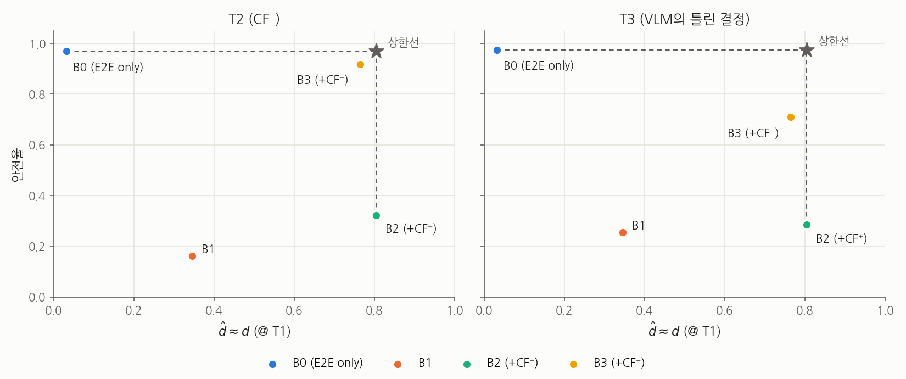
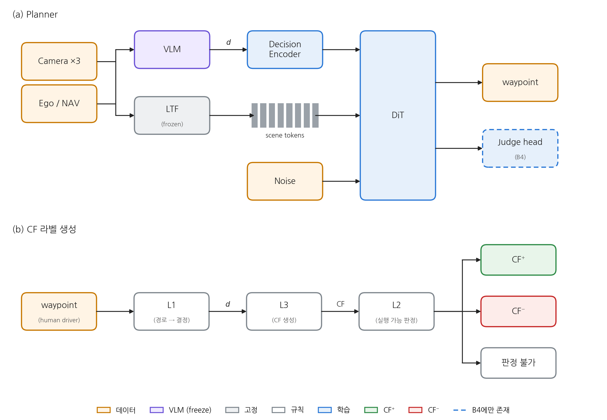
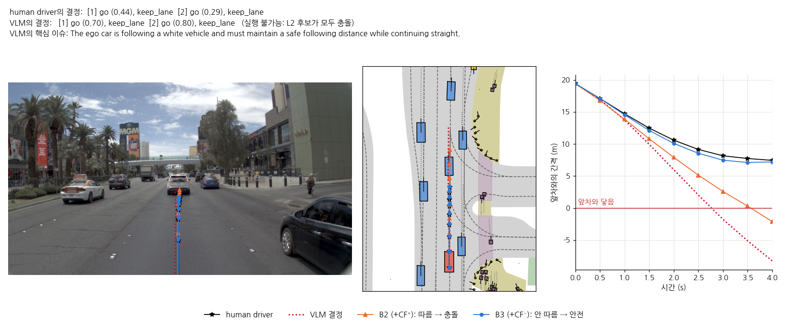
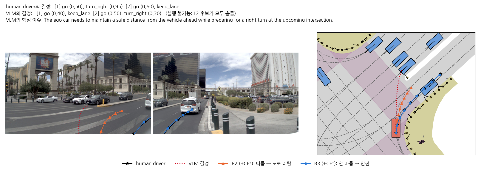
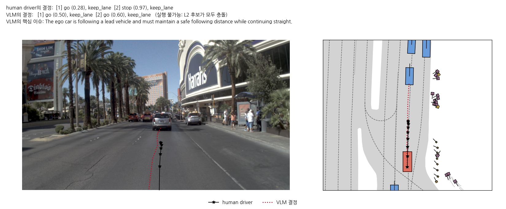

**YESMAN**: **Y**our **E**go-planner **S**houldn't **M**indlessly **A**ccept **N**onsense

## 문제

Vision-Language Model(VLM)이 high-level decision을 내리고 End-to-End(E2E) planner가 그 결정을 입력받아 경로를 생성하는 구조의 연구가 늘고 있다. 그러나 VLM의 high-level decision도 틀릴 수 있다. 예를 들어 앞차와의 거리가 가까움에도 속도를 높이라고 지시할 수 있다. 이번 연구에서는 실행 가능한 결정만 학습한 E2E planner가 이러한 결정을 입력받았을 때 안전한 경로를 대부분 생성하지 못한다는 것을 보인다. 이어서 실행할 수 없는 결정의 예를 함께 학습시키면 안전율이 높아지는지 검증한다. 또한 규칙으로 만든 오답과 실제 VLM의 오답은 구성이 다를 수 있다. 따라서 규칙으로 만든 오답만으로 평가하면 결과가 어떻게 달라지는지도 확인한다.

## 접근

장면마다 human driver의 high-level decision(waypoint로부터 역산)을 여러 방식(규칙 기반 변형, 종·횡방향 동시 변경, 다른 장면의 사람 결정 적용)으로 바꾼 counterfactual decision(CF)을 만들고 NAVSIM 채점 도구로 실행 가능 여부를 자동으로 판정하였다. human driver의 결정과 다른 결정 중 실행 가능한 것은 CF⁺, 실행할 수 없는 것은 CF⁻로 분류하였다. 실행 가능한 결정만 학습한 planner(B2)와 CF⁻까지 함께 학습한 planner(B3)의 안전율을 학습에 사용하지 않은 실제 VLM(Gemma 4 31B)의 실행할 수 없는 결정 397개로 비교하였다.



*Figure 1. 가로축 $ \hat{d} \approx d $ (@ T1)은 실행 가능한 결정(T1)을 입력했을 때 생성한 경로가 결정과 일치한 비율(결정–경로 일치율)이다. 세로축은 실행할 수 없는 결정을 입력했을 때 생성한 경로가 사고를 피한 비율(안전율)이다. 왼쪽은 규칙 기반 CF⁻(T2, n = 16,756), 오른쪽은 실제 VLM(Gemma 4 31B)의 틀린 결정(T3, n = 397)에서의 안전율이다. B0(E2E only)는 결정을 입력받지 않는 모델이다. B1은 human driver의 결정과 경로만 학습한 모델이다. 상한선(★)은 B2의 일치율과 B0의 안전율을 합친 점이다(점선). 상한선에 가까울수록 바람직하다. 점수는 시드 2개의 평균이다.*

## 결과

| 모델 | $ \hat{d} \approx d $ ↑ (@ T1) | $ \hat{d} \approx d $ ↓ (@ T3) | 안전율 ↑ (@T3) | 주행 점수 ↑ (@T0) |
| --- | ---: | ---: | ---: | ---: |
| B2 | **80.5%** | 50.8% | 28.5% | **0.939** |
| B3 | 76.5% | **23.9%** | **70.9%** | **0.939** |

T0는 사람의 결정, T1은 규칙 기반으로 만든 실행 가능한 결정(CF⁺), T3는 실제 VLM(Gemma 4 31B)의 실행할 수 없는 결정 397개이다.

- B2(실행 가능한 결정만 학습한 planner)는 VLM의 틀린 결정 중 50.8%를 그대로 따랐다. 따르지 않은 경우에도 안전한 경로는 41.9%에 그쳐 전체 안전율은 28.5%였다.
- CF⁻를 함께 학습한 B3는 실행 가능한 결정을 따르는 능력(80.5% → 76.5%)과 주행 점수(0.939)를 대부분 유지하면서 안전율을 28.5%에서 70.9%로 약 2.5배 높였다.
- 규칙으로 만든 오답(T2)으로 평가하면 B3의 안전율이 91.8%로 약 21%p 높게 측정된다. 실제 VLM의 오답은 속도(강도) 오류가 절반 이상으로 구성이 달랐다. 이러한 유형을 포함한 CF⁻를 학습해야 안전율이 높아졌다(개발 세트의 탐색적 분석).
- 다만 B3의 안전율은 결정을 입력받지 않는 B0(97.5%)에 미치지 못한다. 또한 평가한 실제 VLM의 오답은 한 VLM이 낸 결정 중 2.2%(397개)이다.

<!-- detail -->

## 0 TL;DR

VLM의 결정을 입력받는 E2E planner를 모방학습으로 실행 가능한 결정만 학습시키면 VLM의 틀린 결정에서 안전한 경로를 생성하지 못하는 경우가 많다(안전율 28.5%). 실행할 수 없는 결정의 예를 함께 학습시키면 안전율이 70.9%로 높아진다.

## 1 배경

### 1.1 연구 배경

Vision-Language Model(VLM)은 real-world의 일반적인 지식을 포함하고 있기 때문에 End-to-End(E2E) 대비 long-tail 상황에서의 일반화를 기대할 수 있어 자율주행 분야에서도 많은 연구가 진행되고 있다. 최근에는 VLM이 상황 설명과 high-level decision을 출력하고 별도의 planner가 그 결정과 영상 특징을 함께 입력받아 low-level trajectory를 생성하는 hybrid 구조가 연구되고 있다 [1, 3, 4].

그러나 VLM도 상황을 잘못 판단하거나 결정을 잘못 내릴 수도 있다. 잘못된 결정을 입력받은 planner는 어떻게 동작할 것인가에 대한 시나리오는 두 가지가 있다.

1. 잘못된 결정을 그대로 따른다. 잘못된 결정을 따랐기 때문에 도로를 벗어나거나 다른 오브젝트와 충돌한다.
2. 잘못된 결정을 따르지 않는다. E2E planner가 안전한 대체 경로를 생성한다.

#### 문제 1

기존 hybrid 구조 연구는 planner가 VLM의 결정을 더 충실하게 따르도록 만드는 방향으로 진행되고 있다 [1]. 반면 VLM의 틀린 결정이 planner로 입력되었을 때 planner가 위 두 가지 중 어떻게 동작하는지는 평가되지 않았다. 모방학습(Imitation Learning, IL)에서 planner의 학습 데이터는 사람이 실제로 주행한 경로이므로 planner는 실행 가능한 결정과 그에 맞는 경로만 학습하게 된다. 이러한 planner가 틀린 결정을 입력받았을 때의 행동은 충분히 측정되지 않았다 **(문제 1)**.

#### 문제 2

잘못된 지시를 학습 데이터에 포함한 선행 연구가 있다 [2]. 그러나 하나의 장면에 대하여 그것의 효과를 설명하는데에 그쳤으며 그에 대한 성능을 정량적으로 측정하지 않았다. 또한 ❓ 잘못된 지시에 대한 강건성을 다룬 연구들은 사람이 설계하거나 규칙으로 생성한 지시를 사용하였다 [5, 6]. 이들 연구는 실제 VLM이 출력한 틀린 결정으로 평가하지 않았다 **(문제 2)**.

### 1.2 관련 연구

#### VLM for Autonomous Driving

Senna [3]와 DiffVLA [4]는 VLM이 결정을 내리고 별도의 planner가 경로를 생성하는 구조를 제안하였다. 특히 DiffVLA는 VLM의 결정을 diffusion planner에 입력한다. Senna-2 [1]는 VLM의 결정과 planner의 경로 사이의 일관성을 높이기 위해 세 단계의 학습을 제안하였다. 마지막 단계에서는 3DGS 환경을 통해 closed-loop에서 강화학습(RL)으로 안전성과 효율을 보강하였다. 이처럼 기존 연구는 planner가 VLM의 결정을 충실히 따르도록 하는 데 초점을 두었다. 본 연구는 planner 학습에서 기본이 되는 모방학습에 한정하여 틀린 결정이 입력되었을 때 planner가 어떻게 행동하는지 평가한다.

#### Robustness to Wrong Instructions

Carton et al. [5]은 CARLA의 교차로에서 잘못된 주행 명령을 주었을 때 주행 agent의 위험 행동(충돌, 도로 이탈, 교차로 안에서의 정지)을 측정하였다. 제안한 강화학습 agent뿐 아니라 비교 대상인 모방학습 agent(LBC)도 60회 중 23회 위험 행동을 보였다. ICR-Drive [6]는 언어 지시를 바꾸거나 오도하는 지시를 주었을 때 LMDrive [2]와 BEVDriver의 주행 성능이 크게 하락함을 보였다. 그러나 이들 연구는 측정에 그쳤다. 이를 학습으로 개선하는 방법은 다루지 않았다.

#### Learning from Negative Examples

ChauffeurNet [7]은 사람의 주행 경로를 교란한 데이터와 충돌에 벌점을 주는 손실을 추가하여 정답 주행만 모방하는 학습의 한계를 보완하였다. LMDrive [2]는 교통 법규를 위반하는 잘못된 지시를 학습 데이터에 추가하여 모델이 이를 거부하도록 학습시켰다. 그러나 그 효과를 정량적으로 측정하지 않았으며 도로 모양에 따른 오답만 다루었다. SafeDriveVLA [8]는 내비게이션 지시와 장면이 충돌하는 경우 world model로 지시를 따른 결과를 예측하여 위험한 지시를 무시하는 방법을 제안하였다.

위 연구들은 모두 내비게이션이나 사람처럼 외부에서 주어진 지시를 다루었다. 잘못된 지시도 사람이 설계하거나 규칙으로 생성하였다. 반면 본 연구는 hybrid 구조에서 상위 VLM 자신이 출력한 틀린 결정을 다룬다. 또한 정답만 학습한 planner의 한계와 오답 예 학습의 효과를 같은 구조에서 통제 비교하고 실제 VLM의 오답으로 평가한다.

### 1.3 핵심 아이디어

본 연구에서 언급하는 '틀린 결정'이란 다른 오브젝트와 충돌하거나 도로를 이탈하거나 역주행을 발생시키는 결정을 말한다. 어떤 장면을 보고 VLM이 고수준 결정(high-level decision)을 출력했을 때 해당 결정에 대한 다양한 후보 경로들 중 어느 경로도 NAVSIM 채점에서 충돌, 도로 이탈, 역주행을 피하지 못하는 경우에 '틀린 결정'이라고 말한다. 후보 경로란 해당 결정과 동일한 결정을 했던 다른 장면들의 waypoint들을 모아 후보 경로들을 이룬다.

#### 주장 1

**(문제 1)**에 대하여 실행 가능한 결정만 학습한 planner는 VLM의 실행할 수 없는 결정을 입력받았을 때 안전한 대체 경로를 생성하지 못한다.

#### 주장 2

실행할 수 없는 결정과 그 장면에서의 안전한 경로를 묶은 counterfactual data(CF⁻)를 함께 학습시키면 모델 구조를 변경하지 않고도 실행할 수 없는 결정에 대한 안전율이 상승한다. 이때 실행 가능한 결정을 따르는 능력과 주행 점수는 대부분 유지된다.

#### 주장 3

**(문제 2)**에 대하여 규칙으로 생성한 오답과 실제 VLM의 오답은 구성이 다르다. 따라서 규칙으로 생성한 오답만으로 평가하면 CF⁻를 학습한 planner의 안전율이 실제 VLM 오답에서보다 높게 측정된다. 또한 학습에 사용하는 CF⁻도 실제 VLM 오답과 같은 유형의 결정 변화를 포함해야 한다.

#### 기여

- 실제 VLM이 출력한 틀린 결정을 planner에 입력하여 정답만 학습한 planner의 무조건적 충실도와 안전율을 측정하였다.
- 사람의 결정을 바꾼 counterfactual decision을 NAVSIM 채점으로 실행 가능 여부를 자동 판정하여 CF⁺와 CF⁻로 나누는 방법을 구성하였다.
- 실행할 수 없는 결정(CF⁻)을 함께 학습시키면 모델 구조를 바꾸지 않고도 안전율이 28.5%에서 70.9%로 오르는 것을 보였다.

## 2 방법론

### 2.1 결정과 라벨



*Figure 2. 전체 구조. (a) Planner. VLM은 카메라 영상과 ego 상태·내비게이션 명령(NAV)을 보고 결정 $ d $를 출력한다. decision encoder가 $ d $를 토큰으로 바꾼다. 고정된 LTF는 같은 입력에서 장면 토큰을 추출한다. DiT는 무작위 노이즈 경로(Noise)에서 시작하여 결정 토큰과 장면 토큰을 참조하면서 노이즈를 10단계에 걸쳐 걷어내 waypoint를 생성한다. 점선으로 표시한 판단 head는 B4에만 있다. (b) CF 라벨 생성. L1이 human driver의 waypoint에서 결정 $ d $를 추출한다. L3가 $ d $를 바꾼 CF를 만든다. L2가 CF의 실행 가능 여부를 판정하여 CF⁺, CF⁻, 판정 불가로 나눈다. 색은 데이터(주황), freeze한 VLM(보라), 고정 모듈(회색), 규칙 기반 라벨러(흰색), 학습하는 모듈(파랑)을 나타낸다.*

#### Decision 형식

VLM의 high-level decision은 두 개의 구간으로 구성된다. 첫 번째 구간은 미래 0초부터 2초까지 구간의 maneuver을 나타내며 두 번째 구간은 미래 2초부터 4초까지 구간의 maneuver을 나타낸다. maneuver에는 종방향 행동과 횡방향 행동, 그리고 각각의 강도(0~1)으로 구성되어 있다.

- 종방향 행동: go, stop
- 횡방향 행동: keep lane, offset(좌/우), 차로 변경(좌/우), 회전(좌/우)

| 행동 | 강도의 정의 |
| --- | --- |
| go | 구간 끝 속도 ÷ 10.5 m/s |
| stop | 구간 동안의 속도 감소량 ÷ 2.8 m/s |
| 회전 | 구간 동안의 heading 변화 ÷ 45° |
| offset | 횡방향 이동 거리 ÷ 1.7 m |
| 차로 변경 | 최대 횡방향 속도 ÷ 2.0 m/s |

예를 들어 "[1] go (0.50), keep lane [2] go (0.60), keep lane"은 차로를 유지하면서 2초 뒤 약 5.3 m/s, 4초 뒤 약 6.3 m/s로 주행하라는 결정이다.

#### 라벨러

라벨은 세 단계로 생성한다. 세 단계 모두 사람의 추가 라벨링 없이 지도와 NAVSIM 채점 도구로 자동 생성한다.

- L1 (경로 → 결정)
    - decision d를 E2E planner에 입력해서 waypoint w를 뽑아내는데 ( $ w = f(d) $ ) 그것의 역 $ \hat{d} = f'(w) $ 을 계산하여 waypoint에 해당하는 원래 decision이 무엇이었는지 계산하는 모듈이다.
    - 지도의 차로 중심선을 기준으로 경로를 진행 거리와 횡방향 거리로 변환하고 규칙에 따라 결정을 추출한다.
    - 학습 라벨을 생성할 때와 모델이 결정을 따랐는지 평가할 때 같은 함수를 사용한다.
- L2 (실행 가능 판정)
    - navtrain의 human driver 경로 모음에서 해당 결정에 맞는 경로를 선택하여 판정할 장면의 차로 위에 배치한다.
    - NAVSIM v2 채점 도구로 충돌, 도로 이탈, 역주행을 확인한다.
    - 세 항목을 모두 통과하는 후보가 하나라도 있으면 실행 가능, 하나도 없으면 실행 불가능, 후보가 5개 미만이면 판정 불가로 분류한다.
    - 지도와 다른 차량의 미래 움직임은 판정에만 사용하며 모델 입력에는 포함하지 않는다.
- L3 (counterfactual decision, CF)
    - human driver의 원래 결정을 의도적으로 바꾼 결정을 L2로 판정하여 실행 가능하면 CF⁺, 실행 불가능하면 CF⁻로 분류한다.
    - CF⁻는 실행할 수 없는 이유에 따라 도로 모양 / 다른 차·보행자 / 강도 기준으로 나눈다. 강도 기준은 행동의 종류는 실행 가능하지만 강도가 지나쳐 실행할 수 없는 결정을 말한다(e.g. 앞차가 있는데 human driver보다 높은 속도를 지시).

CF는 세 가지 방식으로 생성한다.

| CF 생성 방식 | 내용 |
| --- | --- |
| 규칙 기반 CF | 정해진 목록에 따라 한 번에 한 가지 요소만 바꾼다(횡방향 행동 변경, 속도 ±0.3, 정지 등). 장면마다 최대 12개 |
| 확장 CF | 종방향과 횡방향을 동시에 바꾸거나 강도를 무작위로 설정한다. 장면마다 4개 |
| plausible CF | VLM을 사용하지 않고 그럴듯하지만 이 장면에는 맞지 않을 수 있는 사람의 결정을 현재 장면에 적용한다. (1) 내비게이션 명령이 같고 속도 차이가 2 m/s 이내인 다른 로그의 장면 중 인코더 특징이 가장 유사한 10개 장면의 결정, (2) 같은 로그에서 약 1.5초 전 장면의 사람 결정을 사용한다 |

학습 목표(target) 경로는 샘플의 종류에 따라 다르다. 사람의 원래 결정과 CF⁻에는 그 장면에서 사람이 실제로 주행한 경로를 지정한다. 즉, CF⁻는 "이 결정을 입력받더라도 사람처럼 안전하게 주행하라"는 예이다. CF⁺에는 사람의 경로에서 결정이 변경을 지시한 부분(속도 또는 횡방향 위치)만 수정한 경로를 지정한다.

### 2.2 모델

하기하는 모델들의 planner는 모두 같은 고정 인코더와 같은 diffusion 디코더를 사용한다.

#### Planner

- Input
    - 전방 카메라 3대의 이미지, 차량 상태, 내비게이션 명령
    - VLM의 결정

- Do
    - encoder (frozen)
        - NAVSIM [10]에 구현된 Latent TransFuser(LTF)[11]의 사전 학습 체크포인트를 고정하여 사용한다.
        - 장면 토큰 96개(256차원)를 한 번 추출하여 저장한다.
    - decision encoder
        - 구간마다 행동의 종류(one-hot)와 강도를 MLP에 입력하여 토큰 하나로 변환한다.
    - diffusion decoder (DiT)
        - waypoint 8개(4초, 0.5초 간격)를 토큰으로 하는 4층 Transformer 디코더이며 파라미터는 450만 개이다.
        - self-attention으로 waypoint 간의 관계를, cross-attention으로 장면 토큰과 결정 토큰을 참조한다.
        - x0 예측 방식으로 학습하고 DDIM 10단계로 샘플링한다.
        - RTX 5090에서 장면 하나의 경로 생성(DDIM 10단계)에 약 7.5 ms, 인코더에 약 5.1 ms가 걸린다.

- Output
    - 미래 4초 경로 (waypoint 8개, 각각 x, y, heading)

planner로 diffusion 기반 디코더를 사용한 이유는 다음과 같다. 결정과 장면이 충돌하는 경우 (장면 맥락에 맞지 않는 VLM 결정이 들어왔을 때) 결정을 따르는 경로와 장면에 맞는 경로가 모두 학습 데이터에 존재하게 된다. 회귀 방식은 이 두 경로의 평균에 가까운 어느 쪽에도 맞지 않는 경로를 출력할 수도 있는 반면 diffusion은 경로의 분포에서 표본을 생성하므로 이 문제를 피할 수 있다 [9]. 또한 VLM의 결정을 diffusion planner에 입력하는 구조는 DiffVLA [4]에서 사용되었다.

#### 비교군

각 구성 요소의 기여를 분리하기 위해 구성 요소를 하나씩 추가하는 방식으로 비교군을 구성하였다.

| 모델 | 결정 입력 | 학습 데이터 | 역할 |
| --- | :---: | --- | --- |
| B0 | ✕ | human driver 경로 | E2E 단독 모델 |
| B1 | ○ | human driver 결정 및 경로 | 결정 입력의 효과 |
| B2 | ○ | + CF⁺ | human driver 결정과는 다르지만 실행 가능한 결정도 학습 |
| **B3** | ○ | + CF⁺ + CF⁻ | **실행할 수 없는 결정까지 학습** |

추가 실험으로 B3에 명시적인 판단(ACCEPT / REJECT)을 출력하는 head를 더한 모델(B4)을 비교하였다.

### 2.3 실험 설정

> 본 연구는 어떤 기관에 소속되거나 어떠한 외부 지원 없이 개인적으로 수행한 연구이다. 따라서 cloud computing resource 점유 경쟁과 rental 비용에 상당한 제약이 있어 실험의 규모는 작게 설정하였다. 그에 따라 이 연구는 SOTA 급 성능을 제시하는 것이 아닌 ablation을 중심으로 공정한 비교 분석 연구가 핵심이 된다. 그럼에도 연구의 주장을 뒷받침하기에 충분하다고 판단하였다.

#### Dataset

NAVSIM navtrain(nuPlan [12] 기반)의 카메라 데이터 32조각 중 28조각에 대해 train-val 세트, test 세트로 분리하였다.

- train-val: 24조각, 72,806장면 (val은 그 중 로그 88개)
- test: 4조각, 18,880장면 (학습과 검증에 사용하지 않은 4조각)

학습 데이터의 구성은 아래와 같다.

| **trainset** 구성 요소 | 개수 | target 경로 |
| --- | ---: | --- |
| human driver의 결정 | 62,972 | human driver의 경로 |
| CF⁺ | 428,639 | 결정대로 수정한 경로 |
| CF⁻ | 94,818 | human driver의 경로 |

테스트 세트는 입력하는 결정의 종류에 따라 네 가지로 구성하였다.

| **testset** 구성 요소 | 입력 | 개수 |
| --- | --- | ---: |
| T0 | human driver의 결정 | 18,219 |
| T1 | 규칙 기반 CF⁺ | 75,767 |
| T2 | 규칙 기반 CF⁻ | 16,756 |
| T3 | 실제 VLM(Gemma 4 31B)의 결정 중 실행 불가능한 결정 | 397 |

T0의 18,219장면에 대한 영상을 VLM에 입력해서 나온 결정들을 L2 라벨러로 판정하여 실행 불가능한 결정들을 모아 구성하였다. VLM에는 planner와 같은 전방 카메라 3대의 이미지, 차량의 속도와 가속도, 내비게이션 명령을 입력하였으며 장면 설명, 핵심 이슈, 결정의 세 단계를 JSON 형식으로 출력하도록 구성하였다. 모든 planner는 실제 VLM의 결정을 학습에 사용하지 않았으므로 T3는 학습에 사용하지 않은 VLM의 오답에 대한 일반화 성능을 나타낸다.

#### Metrics

- 결정–경로 일치율($ \hat{d} \approx d $ @ T1): 실행 가능한 결정(T1)을 입력받았을 때 결정대로 경로를 생성한 비율. 생성한 경로에서 L1으로 추출한 결정이 입력한 결정과 구간마다 행동의 종류가 같고 강도 차이가 ±0.2 이내이면 일치로 판정한다.
- 무조건적 충실도(unconditional faithfulness, $ \hat{d} \approx d $ @ T2, T3): 실행할 수 없는 결정을 입력받았을 때 결정대로 경로를 생성한 비율. 낮을수록 바람직하다.
- 안전율(no infraction @ T2, T3): 실행할 수 없는 결정을 입력받았을 때 생성한 경로가 충돌, 도로 이탈, 역주행을 모두 피한 비율. 결정을 따랐는지와 관계없이 경로의 결과만 판정한다(사전 등록한 주 지표). 이 연구가 기대하는 행동, 즉 결정을 따르지 않고 사고도 내지 않은 비율($ \hat{d} \not\approx d $ && no infraction)은 TABLE 2에서 따로 보고한다.
- 주행 점수: 사람의 결정(T0)을 입력했을 때 NAVSIM v2 EPDMS의 채점 항목으로 장면마다 계산한 점수의 평균. 연속된 두 프레임이 필요한 확장 편안함(EC) 항목은 제외했으므로 리더보드의 EPDMS와 직접 비교할 수 없다.
- 95% 구간: 두 모델의 차이 뒤 대괄호 안의 값이다. 같은 결정 위에서 두 모델의 결과를 짝지어 차이를 구하고(결정마다 두 시드 평균) 결정을 복원 추출로 5,000번 다시 뽑아 얻은 차이 분포의 2.5~97.5 백분위이다(짝지은 부트스트랩). 구간이 0을 포함하지 않으면 그 차이는 평가 결정의 표본 변동만으로는 설명하기 어렵다. 시드 간 변동은 구간에 포함되지 않는다.

#### Miscellaneous

- 모든 모델은 AdamW(learning rate 2e-4, batch size 256)로 80,000 step 학습하였다.
- 모든 모델은 시드 0과 1로 학습하였으며 결과는 두 시드의 평균값을 보고하였다.
- 학습 step 수와 CF의 가중치는 검증 세트에서 선택하였다.
- 테스트 세트는 체크섬으로 고정한 뒤 모든 학습과 선택이 끝난 후 한 번만 평가하였다. 모델 선택 규칙과 비교의 성공 기준은 결과를 확인하기 전에 문서로 고정하였다(사전 등록). 사전 등록한 비교는 B4를 기준으로 하였으며 그 결과는 3절의 추가 실험에서 보고한다. B0~B3 사이의 차이와 구간은 테스트 결과를 확인한 뒤 같은 방법으로 계산하였다.
- 테스트 결과를 확인한 뒤에 수행한 분석은 본문에 사후 분석으로 표기하였다.

## 3 실험 결과

> cloud computing resource 점유 경쟁과 rental 비용의 제약으로 축소된 실험의 결과로 fine-tuning, 하이퍼파라미터 변경 등으로 성능 개선의 여지가 있다.

**TABLE 1. 전체 결과**

| 모델 | 결정–경로 일치율 @ T1 | 안전율 @ T2 | 안전율 @ T3 | 주행 점수 @ T0 |
| --- | ---: | ---: | ---: | ---: |
| B0 | 3.1% | 96.9% | 97.5% | 0.938 |
| B1 | 34.6% | 16.2% | 25.4% | 0.946 |
| B2 | **80.5%** | 32.3% | 28.5% | **0.939** |
| B3 | 76.5% | **91.8%** | **70.9%** | **0.939** |

B0는 E2E only 모델로 high-level decision에 영향을 전혀 받지 않기 때문에 타 모델 대비 가장 뛰어난 점수에도 볼드 처리를 하지 않았다. 결과 데이터는 시드 두 개의 평균 값을 보고하였다. 두 시드의 민감도는 B1의 T2 안전율(5.3%p)을 제외하면 모두 2%p 이내이다(시드별 값은 부록 TABLE A1).

#### 주장 1에 대한 근거

주장 1을 뒷받침하는 근거는 TABLE 1, 2, 3에서 찾을 수 있다.

TABLE 1의 핵심 비교 대상은 'B0 vs B1', 'B1 vs B2'이다.

- B0 vs B1
    - 결정을 입력받지 않는 B0의 안전율(T3)은 97.5%인 반면 사람의 결정만 학습한 B1은 25.4%이다(−72.0%p [95% 구간 −76.3, −67.8]). 두 모델의 차이는 결정 입력 여부뿐이므로 이 차이는 결정을 입력으로 받는 것 자체에서 발생하는 위험을 나타낸다.
- B1 vs B2
    - CF⁺를 추가로 학습한 B2는 결정–경로 일치율이 34.6%에서 80.5%로 상승하였으나 안전율(T3)은 25.4%에서 28.5%로 거의 변하지 않았다(+3.0%p [95% 구간 −1.4, +7.4]). 즉, 실행 가능한 결정을 더 잘 따르도록 학습시키는 것만으로는 실행할 수 없는 결정에 대한 안전이 확보되지 않는다.

**TABLE 2. VLM의 틀린 결정(T3)에 대한 planner의 행동 (사후 분석)**

| 모델 | 따름·사고 | 따름·안전 | 안 따름·사고 | **안 따름·안전** | 안전율 |
| --- | ---: | ---: | ---: | ---: | ---: |
| B1 | 61.0% | 5.4% | 13.6% | 20.0% | 25.4% |
| B2 | 42.9% | 7.8% | 28.6% | 20.7% | 28.5% |
| B3 | **17.8%** | 6.2% | **11.3%** | **64.7%** | **70.9%** |

TABLE 2는 VLM의 틀린 결정(T3)마다 planner가 결정을 따랐는지($ \hat{d} \approx d $)와 사고(충돌, 도로 이탈, 역주행)가 났는지를 함께 나누어 본 결과이다. 네 칸의 합은 100%이다. 안전율은 따름·안전과 안 따름·안전의 합이다. 이 연구가 기대하는 행동은 결정을 따르지 않고 안전한 경로를 생성하는 것(안 따름·안전)이다.

- B2는 실제 VLM의 실행 불가능한 결정 중 50.8%를 그대로 따랐다. 이 중 대부분은 사고로 이어졌다(42.9%). 결정을 따르지 않은 49.2% 중에서도 안전한 경로는 20.7%(따르지 않은 경우의 42%)에 그쳤다. 즉, B2가 결정을 따르지 않았다는 것이 안전한 경로를 생성했다는 것을 의미하지 않는다.
- 따름·안전은 L2가 실행 불가능으로 판정하였지만 모델이 결정을 따르면서도 사고를 내지 않은 경우이다(5~8%). L2 판정이 보수적이기 때문에 생긴다(4.2절). 사전 등록한 안전율에는 포함된다. 이 칸을 빼고 안 따름·안전만 세어도 B3 − B2는 +44.1%p [95% 구간 +39.5, +48.6]로 안전율의 차이(+42.4%p)와 결론이 같다.

B2가 결정을 따르지 않았는데 사고가 난 경로가 어디에 있는지 보기 위해 모델 경로를 human driver의 경로와 결정의 경로 사이에 투영한 위치 φ를 계산하였다(사후 분석). 결정의 경로로는 VLM의 결정에 맞는 L2 후보 경로 중 가장 나은 것을 사용하였다. φ = 0이면 
human driver와 같고 φ = 1이면 결정대로 주행한 것이다. B2가 결정을 따르지 않고 사고를 낸 경로 227개(두 시드 합) 중 70%는 φ ≥ 0.25로 human driver의 경로에서 결정 쪽으로 치우쳐 있었다. 반면 B3가 결정을 따르지 않고 안전했던 경로 514개 중 87%는 φ < 0.25로 human driver의 경로와 거의 같았다. 즉, B2의 대체 경로는 결정을 일부만 실행한 경로가 많았다. B3의 대체 경로는 human driver처럼 주행한 경로가 대부분이었다.





*Figure 3. 같은 T3 장면에서 B2와 B3의 경로. 검은 별표 선은 human driver의 경로, 빨간 점선은 VLM의 결정에 맞는 L2 후보 경로, 주황 세모 선은 B2, 파란 동그라미 선은 B3의 경로이다. L2 후보 경로는 모델이 생성한 경로가 아니라 다른 장면에서 human driver가 실제로 주행한 경로 중 이 결정에 맞는 것을 이 장면의 차로 위에 옮긴 것이다. 그중 가장 나은 것(모두 탈락)을 그렸다. (위) VLM이 앞차를 서술하고도 human driver보다 빠른 속도를 지시한 장면. 오른쪽 그래프는 앞차의 뒤끝과 ego의 앞끝 사이의 간격이다. B2는 결정을 따라 약 3.5초에 앞차와 닿아 충돌로 판정된다. B3는 결정을 따르지 않고 human driver와 비슷한 간격을 유지한다. (아래) VLM이 human driver보다 늦고 약한 우회전을 지시한 장면. B2는 결정을 따라 늦게 회전하여 2.9초 이후 차체 앞모서리가 교통섬(흰색, 주행 불가 영역)에 들어가 도로 이탈로 판정된다. B3는 human driver와 같은 경로로 회전한다. B3와 human driver의 경로는 곧바로 오른쪽으로 꺾기 때문에 대부분 오른쪽 카메라 영상에 보인다. 카메라 영상에는 차 앞 약 7 m 안쪽이 찍히지 않으므로 그 구간의 경로는 화면 테두리에서 잘린 선으로만 그렸다. 두 장면 모두 두 시드의 결과가 같다.*

한편 결정을 더 잘 따르도록 학습한 B2의 무조건적 충실도(50.8%)는 B1(66.4%)보다 낮았다. 연구 초기에 세운 가설("결정을 잘 따르도록 학습할수록 틀린 결정도 더 따른다")은 기각되었다. TABLE 3은 규칙 기반 CF에서 결정의 종류별로 실행 가능한 결정(T1)과 실행 불가능한 결정(T2)에 대한 충실도를 비교한 결과이다.

**TABLE 3. 규칙 기반 CF에서 결정 종류별 충실도: 실행 가능 / 실행 불가능 (사후 분석)**

| 결정 | 개수 | B1 | B2 | B3 |
| --- | ---: | ---: | ---: | ---: |
| 더 빠르게 | 11,791 / 1,539 | 89.7% / 87.5% | 78.2% / 38.3% | 68.9% / 10.5% |
| 오른쪽 차로 변경 | 5,569 / 2,248 | 0.7% / 0.2% | 69.7% / 42.3% | 60.5% / 9.2% |
| 회전 (좌·우) | 5,971 / 11,110 | 72.7% / 39.0% | 65.4% / 21.6% | 59.0% / 0.8% |
| 왼쪽 차로 변경 | 5,928 / 1,603 | 1.5% / 1.1% | 66.2% / **60.5%** | 57.6% / 18.5% |

- B1은 "더 빠르게"를 실행 가능 여부와 무관하게 따랐다(89.7% / 87.5%). 차로 변경은 거의 실행하지 못했다(1% 내외).
- B2는 대부분의 결정 종류에서 실행 불가능한 경우의 충실도가 낮았다("더 빠르게" 78.2% → 38.3%, 오른쪽 차로 변경 69.7% → 42.3%, 회전 65.4% → 21.6%). CF⁺는 그 결정이 실행 가능한 장면에서만 만들어지므로 B2는 학습에서 보지 못한 결정과 장면의 조합을 덜 따르게 된 것으로 보인다. 그러나 TABLE 2에서처럼 B2가 따르지 않은 경로는 결정을 일부만 실행한 경로가 많아 안전으로 이어지지 않았다.
- 예외는 왼쪽 차로 변경이다. B2는 실행 불가능한 경우에도 60.5%를 따랐다(실행 가능 66.2%). B2가 따른 실행 불가능한 왼쪽 차로 변경 경로 중 34.5%는 사고가 나지 않았다. 이는 "더 빠르게"(15.1%)나 회전(11.9%)보다 높다. 즉, 이 종류에는 L2가 실행 불가능으로 판정하였지만 실제로는 실행할 수 있는 결정이 상대적으로 많이 섞여 있다. 또한 왼쪽 차로의 다른 차와 충돌하는 경우에 B2는 71.4%를 따랐다. 앞차가 정면에 보이는 "더 빠르게"와 달리 옆 차로의 차는 ego의 옆이나 뒤에 있을 수 있어 전방 카메라로 만든 장면 토큰에서 드러나기 어려울 수 있다.
- CF⁻를 학습한 B3는 모든 종류에서 실행 불가능한 결정의 충실도가 크게 낮았다(0.8~18.5%).

#### 주장 2에 대한 근거

주장 2를 뒷받침하는 근거는 TABLE 1, 2, 4에서 찾을 수 있다.

TABLE 1에서 B2와 B3을 비교하면 아래와 같다. 두 모델의 차이는 학습 데이터에 CF⁻를 포함했는지의 여부에만 차이가 있다.

- 안전율
    - CF⁻를 추가로 학습한 B3는 VLM의 틀린 결정(T3)에서 안전율이 28.5%에서 70.9%로 42.4%p [95% 구간 +38.0, +47.0] 상승하였다. 규칙 기반 CF⁻(T2)에서도 32.3%에서 91.8%로 상승하였다.
- 결정을 따르는 능력
    - 결정–경로 일치율(T1)은 80.5%에서 76.5%로 4.0%p [95% 구간 −4.2, −3.8] 하락하였다. 실제 VLM의 실행 가능한 결정 15,581개에 대해서도 결정대로 경로를 생성한 비율은 B2 76.4%, B3 72.7%로 비슷한 폭으로 하락하였다.
- 주행 점수
    - 사람의 결정을 입력했을 때의 주행 점수(T0)는 두 모델 모두 0.939로 유지되었다.

TABLE 2에서 B3의 무조건적 충실도는 23.9%로 B2(50.8%)의 절반 이하이다. 결정을 따르지 않고 안전한 경로를 생성한 비율(안 따름·안전)은 64.7%로 B2(20.7%)의 약 3배이다. 즉, B3는 실행할 수 없는 결정을 따르지 않을 뿐만 아니라 따르지 않았을 때 장면에 맞는 안전한 경로를 생성한다.

**TABLE 4. 실행할 수 없는 이유별 안전율 (T3)**

| 모델 | 도로 모양 (69) | 다른 차·보행자 (122) | 강도 (206) |
| --- | ---: | ---: | ---: |
| B0 | 91% | 98% | 99% |
| B2 | 54% | 18% | 26% |
| B3 | 78% | 66% | 71% |

TABLE 4에서 B3의 안전율은 세 기준 모두에서 B2보다 높았다(도로 모양 54% → 78%, 다른 차·보행자 18% → 66%, 강도 26% → 71%). 결정을 입력받지 않는 B0은 틀린 결정의 영향을 받지 않으므로 비교 대상이라기보다 틀린 결정이 입력되지 않았을 때의 상한선으로 보는 것이 적절하다.

강도 기준에서 B3의 경로에 남은 사고(29%)는 대부분 앞차와의 충돌이었다(충돌 27.2%, 도로 이탈 1.9%). 사후 분석에서 이 기준의 안전율은 앞차와의 거리와 ego의 속도에 따라 달랐다. 앞차와의 거리가 20~50 m인 경우 61.3%로 10~20 m인 경우(80.6%)보다 낮았다. ego의 속도가 5~10 m/s인 경우 67.1%로 1~5 m/s인 경우(81.8%)보다 낮았다. 앞차가 멀고 ego가 빠른 장면에서 "더 빠르게" 결정이 실행 가능한지는 현재의 거리보다 앞차와의 상대 속도에 달려 있다. 인코더는 현재 프레임 하나만 입력받으므로 앞차의 속도를 추정하기 어렵다. 이것이 이 조건에서 안전율이 낮은 원인일 수 있다.

#### 주장 3에 대한 근거

주장 3을 뒷받침하는 근거는 TABLE 1, 5, 6, 7에서 찾을 수 있다.

**TABLE 5. VLM(Gemma 4 31B)이 출력한 high-level decision의 구성**

| | 실행 가능 | 실행 불가능 | 판정 불가 |
| --- | ---: | ---: | ---: |
| human driver의 결정과 같음 | 4,812 | 15 | 59 |
| human driver의 결정과 다름 | **10,769 (59.1%)** | 382 | 2,182 |
| 합계 | 15,581 | **397 (2.2%)** | 2,241 (12.3%) |

TABLE 5에서 VLM의 결정 중 실행할 수 없는 결정은 2.2%이다. VLM 결정의 대부분은 사람의 결정과 다르지만 실행 가능한 결정이다.

판정 불가(12.3%)는 대부분 L2가 사용할 수 있는 후보 경로가 부족해서 생긴다. L2는 결정과 맞는 human driver 경로를 최대 200개 골라 판정할 장면의 차로 위에 옮긴 뒤 L1으로 다시 읽는다. 행동의 종류와 강도(±0.2)가 여전히 결정과 맞는 후보가 5개 미만이면 판정 불가로 둔다. human driver가 드물게 하는 행동이 들어간 결정은 맞는 후보가 적어 판정 불가가 많았다(차로 변경·offset·회전이 들어간 결정 1,093개 중 58.5%, 두 구간 모두 keep lane인 결정은 9.4%). 이 밖에 교차로가 아닌 곳에서의 회전 226개는 L1이 회전으로 확인할 수 없어 판정 불가로 분류하였다.

**TABLE 6. 규칙 기반 CF⁻(T2)와 실제 VLM 오답(T3)의 구성 비교**

| 구분 | | 규칙 기반 CF⁻ (T2) | 실제 VLM 오답 (T3) |
| --- | --- | ---: | ---: |
| 실행할 수 없는 이유 | 도로 모양 | 52.8% | 17.4% |
| | 다른 차·보행자 | 38.1% | 30.7% |
| | 강도 | 9.1% | **51.9%** |
| 사람의 결정에서 바뀐 요소 | 횡방향 행동만 | **87.4%** | 0% |
| | 그 외 (종방향 행동, 강도, 여러 요소의 조합) | 12.6% | 100% |

선행 연구 [5, 6]와 같이 규칙으로 틀린 지시를 만드는 방식은 정해진 목록에 따라 한 번에 한 가지 요소만 바꾸므로 실제 VLM이 내는 오답과 구성이 같다는 보장이 없다. TABLE 6은 이 연구에서 규칙으로 만든 CF⁻(T2)와 실제 VLM 오답(T3)의 구성이다.

- 규칙 기반 CF⁻는 87.4%가 횡방향 행동만 바꾼 결정인 반면(e.g. 차로가 없는 방향으로 회전) 실제 VLM의 실행 불가능한 결정에는 이러한 결정이 존재하지 않는다.
- 실제 VLM 오답은 51.9%가 강도 기준이다. 그중 79%는 사람보다 더 빠르게 주행하라는 결정이다. 규칙 기반 CF⁻에서 강도 기준은 9.1%이다.
- 실제 VLM의 강도 기준 오답 206개 중 172개(83%)는 VLM이 핵심 이슈로 "앞차와의 안전거리 유지"를 서술한 경우였다. 예를 들어 사람이 2초 뒤 약 2.9 m/s로 감속한 뒤 정지한 장면에서 VLM은 핵심 이슈를 "The ego car is following a lead vehicle and must maintain a safe following distance while continuing straight."로 서술하고도 2초 뒤 약 5.3 m/s, 4초 뒤 약 6.3 m/s로 주행하라는 결정을 출력하였다(Figure 4). 이 예처럼 VLM은 상황을 맞게 서술하고도 속도의 수치를 틀리게 출력하는 경우가 많았다.



*Figure 4. 강도 기준 VLM 오답의 예. 검은 별표 선은 human driver의 경로, 빨간 점선은 VLM의 결정에 맞는 L2 후보 경로이다. 후보는 모두 앞차와 충돌한다.*

이러한 구성의 차이는 평가 결과에 영향을 준다. B3의 안전율은 규칙 기반 CF⁻(T2)에서 91.8%, 실제 VLM 오답(T3)에서 70.9%였다. 규칙으로 생성한 오답만으로 평가하면 안전율이 약 21%p 높게 측정된다. 반면 CF⁻를 학습하지 않은 B1과 B2는 두 세트의 안전율이 비슷하거나 T3에서 오히려 높았다(B1 16.2% vs 25.4%, B2 32.3% vs 28.5%). 즉, 과대 측정은 규칙 기반 CF⁻와 같은 방식으로 만든 오답을 학습한 planner에서 나타난다. 다만 어느 세트로 평가하든 CF⁻를 학습한 B3의 안전율은 B2보다 크게 높았다(T2 +59.6%p, T3 +42.4%p). 규칙 기반 CF⁻로 평가하면 CF⁻ 학습의 효과가 부풀려지지만 효과가 있다는 결론은 실제 VLM 오답에서도 유지된다.

그렇다면 실제 VLM 오답에서의 안전율은 학습한 CF⁻의 무엇에 따라 달라지는가? 이를 확인하기 위해 학습한 CF⁻만 바꾸어 B3를 다시 학습하였다(TABLE 7). 이 분석은 테스트 세트가 아닌 개발 세트(navtest)에서 시드 하나로 수행한 탐색적 분석이다. 실제 VLM 오답은 세 VLM(Gemma 4 12B, Gemma 4 31B, Qwen3-VL 8B)의 실행 불가능한 결정 415개를 합쳐 사용하였다. 기준 모델 (a)는 최종 B3와 일부 학습 설정이 다르다. 따라서 TABLE 7의 숫자는 TABLE 1(테스트 세트, Gemma 4 31B, 시드 2개)과 직접 비교할 수 없다. 행 사이의 차이만 비교한다.

**TABLE 7. 학습한 CF⁻에 따른 B3의 안전율 (개발 세트, 시드 0, 탐색적 분석)**

| | 학습한 CF⁻ | 횡방향 행동만 바꾸지 않은 CF⁻의 비중 | 안전율: 실제 VLM 오답 (415) | 안전율: 규칙 기반 CF⁻ |
| --- | --- | ---: | ---: | ---: |
| (a) | 규칙 기반 + 확장 + plausible | 70.5% | **59.5%** | 80.0% |
| (b) | (a)에서 무작위로 26%만 | 70.5% | 58.6% | 79.4% |
| (c) | 규칙 기반만 | 10.7% | 45.1% | 82.4% |

CF⁺는 세 모델이 같다. CF⁻만 다르다. 확장 CF와 plausible CF에서 나온 CF⁻는 대부분 종방향 행동이나 강도를 바꾸거나 여러 요소를 함께 바꾼 결정이다. 규칙 기반 CF⁻는 약 90%가 횡방향 행동만 바꾼 결정이다.

- (a) vs (b): CF⁻의 개수를 약 1/4로 줄여도 안전율은 거의 같았다(59.5% vs 58.6%).
- (a) vs (c): 확장·plausible CF⁻를 빼면 실제 VLM 오답에 대한 안전율이 14.5%p [95% 구간 −18.8, −10.1] 하락하였다. 규칙 기반 CF만으로 학습하면서 횡방향 행동만 바꾸지 않은 CF⁻의 비중을 70.5%로 높여도 안전율은 일부만 회복되었다(42.4% → 49.6%).
- 규칙 기반 CF⁻에 대한 안전율은 세 모델 모두 79~82%로 차이가 없었다.

즉, 실제 VLM 오답에서의 안전율을 정한 것은 CF⁻의 개수가 아니라 CF⁻가 담은 결정 변화의 종류였다. 실제 VLM 오답처럼 종방향 행동과 강도가 바뀐 CF⁻를 학습해야 실제 VLM 오답에서 안전해진다. 이 차이는 규칙 기반 CF⁻로 평가해서는 드러나지 않는다.

#### 추가 실험: 명시적 판단

B3는 실행할 수 없는 결정을 입력받았을 때 명시적인 거부 없이 결정과 다른 경로를 조용히 생성한다. 만약 명시적으로 거부하는 head를 E2E planner에 추가하면 VLM의 틀린 결정에서 안전율을 상승시킬 수 있을까? 이에 따라 B3에 판단 head를 추가하여 planner가 결정을 ACCEPT / REJECT로 판단하도록 한 모델(B4)을 비교하였다. B4는 DiT 중간 층의 은닉 상태에서 판단을 출력한다. 판단은 경로를 직접 변경하지 않는다.

B4는 사전 등록 당시의 주 모델이다. 이전 실험에서는 판단 head가 DiT와 병렬로 장면 토큰과 결정 토큰을 따로 받았는데 판단 head가 "따른다"고 판단한 결정을 경로는 따르지 않는 불일치가 있었다. 그래서 판단 head가 DiT의 은닉 상태를 읽도록 구조를 바꾼 B4를 기준으로 네 가지 비교와 성공 기준을 테스트 전에 고정하였다. 결과는 다음과 같다.

| 사전 등록한 비교 | 지표 | 결과 [95% 구간] | 성공 기준 | 판정 |
| --- | --- | ---: | --- | --- |
| B4 vs B2 | 안전율 (T3) | +44.2%p [+39.4, +48.7] | 아래끝 > 0 | 성공 |
| B4 vs B3 | 안전율 (T3) | +1.8%p [−1.0, +4.5] | 아래끝 > −5%p | 성공 |
| B4 vs B3 | 결정–경로 일치율 (T1) | −3.2%p [−3.4, −3.0] | 아래끝 > −2%p | 실패 |
| B4 vs 이전 구조 | 판단–경로 불일치율 (T1 ∪ T2) | −1.1%p [−1.3, −1.0] | 위끝 < 0 | 성공 |

B4 vs B2의 성공은 판단 head가 없는 B3에서도 같은 크기로 나타났으므로(+42.4%p) 앞의 주장 2는 B4가 아닌 B3로 보고하였다.

**TABLE 8. 판단 head를 추가한 모델과의 비교**

| 모델 | 결정–경로 일치율 (T1) | 안전율 (T3) | 거부율: 규칙 기반 CF⁻ (T2) | 거부율: 실제 VLM 오답 (T3) |
| --- | ---: | ---: | ---: | ---: |
| B3 | 76.5% | 70.9% | – | – |
| B4 (B3 + 판단 head) | 73.3% | 72.7% | 90% | 37% |

- B4의 안전율은 B3보다 낮지 않았으나(+1.8%p [95% 구간 −1.0, +4.5], 허용 폭 −5%p) 결정–경로 일치율은 B3 대비 3.2%p [95% 구간 −3.4, −3.0] 하락하여 허용 폭(−2%p)을 넘었다.
- 판단은 규칙 기반 CF⁻의 90%를 거부하였으나 실제 VLM의 실행 불가능한 결정은 37%만 거부하였다.
- 사후 분석에서 판단이 거부한 결정은 대부분 B3의 경로가 이미 따르지 않던 결정이었다. B3의 경로가 그대로 따른 결정에 대해서는 판단도 10%만 거부하였다. 판단과 경로 생성이 같은 입력과 같은 CF⁻ 라벨로 학습되기 때문에 같은 결정에서 함께 실패하는 것으로 보인다.

즉, 본 연구의 설계에서 모델에 명시적인 판단을 유도하는 것은 안전율을 개선하지 못했다.

## 4 Conclusion and Discussion

### 4.1 결론

- VLM의 결정을 입력받는 E2E planner가 실행할 수 없는 결정을 입력받았을 때의 행동을 NAVSIM에서 같은 조건으로 측정하였다.
- 실행 가능한 결정만 학습한 planner는 실제 VLM의 실행 불가능한 결정 중 50.8%를 그대로 따랐다(안전율 15.4%). 따르지 않은 나머지에서도 안전율이 41.9%에 그쳐 전체 안전율은 28.5%였다. 결정을 따르지 않고 사고를 낸 경로의 70%는 human driver의 경로에서 결정 쪽으로 치우친 경로, 즉 결정을 일부 실행한 경로였다(사후 분석).
- 실행할 수 없는 결정의 예(CF⁻)를 함께 학습시키면 결정을 따르는 능력과 주행 점수를 대부분 유지하면서 안전율이 70.9%로 상승하였다.
- 규칙으로 생성한 틀린 결정과 실제 VLM의 틀린 결정은 구성이 달랐다. 실제 VLM 오답의 절반 이상은 일반적으로 깊이 정보와 속도 정보가 필요한 강도 기준 오답이었다. 규칙으로 생성한 오답만으로 평가하면 CF⁻를 학습한 planner의 안전율이 약 21%p 높게 측정되었으나 CF⁻ 학습의 효과는 두 평가 세트 모두에서 나타났다.
- 정답만 학습한 planner의 한계(주장 1)와 CF⁻ 학습의 효과(주장 2)는 한 가지 요소만 다른 모델 간의 비교와 한 번만 평가한 테스트 세트로 뒷받침된다. 반면 그 원인에 대한 설명과 CF⁻의 유형에 대한 분석(주장 3의 TABLE 7)은 사후 분석 또는 탐색적 분석에 근거하므로 독립된 데이터에서의 확인이 필요하다.

### 4.2 논의 

L2 판정은 보수적이다. L2는 판정할 장면의 사람 경로가 아니라 다른 장면의 사람 경로를 옮긴 후보만 시험하므로 후보가 장면에 맞지 않으면 실행 가능한 결정도 실행 불가능으로 판정된다. TABLE 2의 따름·안전(B3 6.2%, B2 7.8%)은 이 때문에 생긴다. TABLE 9는 T3의 실행 불가능한 결정 중 평가한 모델 경로 12개(6개 모델 × 시드 2개) 중 하나 이상이 결정을 따르면서 충돌, 도로 이탈, 역주행을 모두 피한 결정의 수이다(사후 분석).

**TABLE 9. "실행 불가능" 판정을 받았지만 결정을 따르면서 안전한 모델 경로가 있는 결정 (T3, 사후 분석)**

| 불가능 이유 | 결정 수 | 따르면서 안전한 경로가 있음 | 엄격한 기준 (강도 ±0.2 허용 없음) |
| --- | ---: | ---: | ---: |
| 도로 모양 | 69 | 27 (39%) | 16 |
| 다른 차·보행자 | 122 | 34 (28%) | 20 |
| 강도 | 206 | 29 (14%) | 11 |
| 전체 | 397 | 90 (23%) | 47 |

사람의 결정과 같은 결정 15개 중 13개가 여기에 포함된다. 또한 도로 모양 기준 69개 중 37개는 사람이 교차로에서 15° 이상 꺾어 L1이 회전으로 분류한 구간을 VLM이 keep lane으로 답한 경우였다. 도로를 따라간다는 의미에서는 VLM의 답이 맞을 수 있으므로 이는 VLM의 오답보다 결정 형식의 정의 차이에 가깝다. 이 90개를 제외해도 B2와 B3의 차이는 유지되었다(B2 20.0%, B3 66.8%). 다만 이 90개는 모델의 결과를 보고 고른 것이므로 참고용이다.

안전율 상승이 결정을 전반적으로 덜 따른 결과일 수 있으므로 실제 VLM의 "더 빠르게" 결정을 실행 가능 여부로 나누어 보았다(사후 분석). 실행 가능한 7,075개의 장면에서는 B2 84.5%, B3 83.3%로 비슷했다. 실행 불가능한 193개에서만 B2 48.2%, B3 26.9%로 차이가 컸다. 따라서 B3의 안전율 상승은 고수준 결정을 덜 따르면서 상승한 것 이상으로 실제로 고수준 결정이 위험한 결정인지 모델이 판단하는 능력이 있다는 것을 말해준다.

### 4.3 한계

- VLM의 결정 중 사람의 결정과 다른 것의 81%는 실행 가능한 결정이다. 본 연구는 실행할 수 없는 결정(전체 VLM 결정의 2.2%)에 대해서만 평가한다.
- CF⁻를 학습한 B3의 안전율(70.9%)은 결정을 입력받지 않는 E2E only 모델인 B0(97.5%)에 미치지 못한다. T3는 실행할 수 없는 결정만 모은 세트이므로 결정을 입력받지 않는 B0가 구조적으로 유리하다. 또한 VLM의 결정이 주행에 도움이 되는 장면(예: 수신호처럼 VLM만 인지할 수 있는 정보)은 따로 구성하거나 확인하지 않았으므로 본 연구는 VLM의 결정이 planner에 도움이 되는지에 대해서는 다루지 않는다.
- NAVSIM은 4초 open-loop 평가이며 다른 차량이 ego의 행동에 반응하지 않는다. 결정을 따르지 않은 이후의 안전은 4초 범위에서만 확인하였다.
- 하나의 데이터셋(nuPlan [12])에서 freeze된 LTF의 장면 토큰 위에 작은 DiT 디코더(4 layers, 4.5M) 하나만 학습한 구조로 검증하였다. LTF까지 함께 학습하는 구조나 더 큰 planner에서도 같은 결과가 나오는지는 확인하지 않았다.
- 실제 VLM 오답은 VLM 하나(Gemma 4 31B), 프롬프트 하나로 수집하였으며 397개로 규모가 작다.
- 다른 장면의 human driver 경로로 VLM 결정의 실행 가능 여부를 판정하기 때문에 실행 가능한 결정이라도 데이터셋에 비슷한 선례가 없으면 실행 불가능으로 분류될 수 있다. T3의 실행 불가능한 결정 397개 중 47~90개(12~23%)는 평가한 모델 중 하나 이상이 결정을 따르면서 안전하게 주행하였다(47개는 엄격한 기준, 90개는 주 기준, 4.2절 TABLE 9).

### 4.4 향후 과제

- 강도 기준 오답: 과거 프레임이나 추적 결과를 이용해 앞차의 속도를 추정하는 방법을 검토할 필요가 있다.
- L2 판정: 다른 장면의 사람 경로를 사용하는 대신 결정으로부터 경로를 직접 생성하여 판정하면 사람이 주행하지 않은 결정도 판정할 수 있어 CF의 다양성, 판정 불가(12.3%), 실행 가능한 결정을 불가능으로 판정하는 문제를 함께 줄일 수 있다. 회전과 keep lane의 경계(교차로에서 도로 자체가 꺾이는 경우)도 VLM 프롬프트와 L1에서 같게 정의해야 한다.
- 판단: 결정대로 생성한 경로의 결과를 근거로 판단하는 구조는 시험하지 않았다.
- 실행 가능하지만 위험한 결정으로의 확장이 필요하다.

## 5 배운 점

규칙 기반으로 생성된 CF⁻를 학습시키고 평가하였을 때 높은 안전율을 모델이 보여주었으나 실제 VLM의 오답으로 평가했을 때 안전율이 크게 하락(규칙 기반 CF⁻ 76.9% → 실제 VLM 3종의 오답 30.3~41.8%)하는 것을 초기 실험에서 경험하였다. 이 경험을 통해 학습 및 평가 데이터의 분포를 확인하여 실제 사용 환경에서 발생하는 케이스를 충분히 커버하는지를 확인해야 한다는 것을 배웠다.

또한 "결정을 실행하지 않은 비율"만 측정했을 때는 정답만 학습한 planner(B2)도 틀린 결정을 실행하지 않는 것처럼 보였으나 생성한 경로를 채점하자 대부분 사고로 이어진 경로였다. 이를 통해 데이터가 보여주는 상황을 다양한 지표로 입체적으로 이해하는 것의 중요성을 깨달았다. 특히 엄밀하고 깊은 사고의 중요성을 알게 되었는데 논리적인 비약이나 모순을 인지하고 필요조건과 충분조건을 구분하여 가설을 세우거나 주장하고 그것을 증명하는 일련의 방법에 대하여 알게 되었다.

초기 실험에서 평가 세트의 결과를 확인하며 설계를 수정했기 때문에 그 평가 세트의 결과를 더 이상 주 결과로 사용할 수 없었다. 이에 따라 사용하지 않은 데이터로 새로운 테스트 세트를 구성하고 성공 기준을 미리 고정한 뒤 한 번만 평가하는 절차를 도입하였다. 이것은 Stanford의 CS229에서 Andrew Ng 교수님이 강조했던 내용이고 이번 실험에서 그것을 적용한 사례이다.

## 6 References

1. Y. Song et al., "Senna-2: Aligning VLM and End-to-End Driving Policy for Consistent Decision Making and Planning," arXiv:2603.11219, 2026.
2. H. Shao et al., "LMDrive: Closed-Loop End-to-End Driving with Large Language Models," CVPR, 2024.
3. B. Jiang et al., "Senna: Bridging Large Vision-Language Models and End-to-End Autonomous Driving," arXiv:2410.22313, 2024.
4. A. Jiang et al., "DiffVLA: Vision-Language Guided Diffusion Planning for Autonomous Driving," arXiv:2505.19381, 2025.
5. F. Carton, D. Filliat, J. Rabarisoa, Q. C. Pham, "Evaluating Robustness over High Level Driving Instruction for Autonomous Driving," IEEE IV, pp. 129–135, 2021.
6. K. Hamid, C. Cui, N. Liang, "ICR-Drive: Instruction Counterfactual Robustness for End-to-End Language-Driven Autonomous Driving," CVPR Workshops, pp. 872–880, 2026.
7. M. Bansal, A. Krizhevsky, A. Ogale, "ChauffeurNet: Learning to Drive by Imitating the Best and Synthesizing the Worst," RSS, 2019.
8. S. Xie et al., "SafeDriveVLA: Navigation-Conditioned World Model Dreaming for Conflict-Aware End-to-End Autonomous Driving," CoRL, 2026. arXiv:2610.20609.
9. C. Chi et al., "Diffusion Policy: Visuomotor Policy Learning via Action Diffusion," RSS, 2023.
10. D. Dauner et al., "NAVSIM: Data-Driven Non-Reactive Autonomous Vehicle Simulation and Benchmarking," NeurIPS Datasets and Benchmarks Track, 2024. arXiv:2406.15349.
11. K. Chitta, A. Prakash, B. Jaeger, Z. Yu, K. Renz, A. Geiger, "TransFuser: Imitation with Transformer-Based Sensor Fusion for Autonomous Driving," IEEE TPAMI, vol. 45, no. 11, pp. 12878–12895, 2023.
12. H. Caesar et al., "nuPlan: A closed-loop ML-based planning benchmark for autonomous vehicles," arXiv:2106.11810, 2021.

## Appendix A. 부록

**TABLE A1. 시드별 값 (시드 0 / 시드 1)**

| 모델 | 결정–경로 일치율 (T1) | 안전율 (T2) | 안전율 (T3) | 주행 점수 (T0) |
| --- | ---: | ---: | ---: | ---: |
| B0 | 3.2% / 3.1% | 97.0% / 96.8% | 97.5% / 97.5% | 0.939 / 0.938 |
| B1 | 33.6% / 35.5% | 18.8% / 13.5% | 25.2% / 25.7% | 0.947 / 0.945 |
| B2 | 80.5% / 80.4% | 31.9% / 32.6% | 28.5% / 28.5% | 0.938 / 0.939 |
| B3 | 76.2% / 76.7% | 91.7% / 91.9% | 71.8% / 70.0% | 0.939 / 0.939 |

사후 분석의 숫자와 계산 코드는 저장소의 `docs/blog_numbers.md`, `scripts/blog_numbers.py`에 있다.

**B. VLM 프롬프트 (T3)**

Gemma 4 31B에 모든 장면에서 같은 프롬프트를 사용하였다. 이미지는 왼쪽·전방·오른쪽 카메라 3장을 이 순서로 입력하였다. 디코딩은 temperature 0(greedy)이고 출력은 JSON 스키마(`scene_description`, `key_issue`, `decision`의 `segment_1`, `segment_2`)로 강제하였다. 프롬프트의 행동 정의와 강도 기준은 planner가 입력받는 결정 형식(L1)과 같게 적었다. 20장면 시범 실행으로 출력 형식만 확인하였다. 결과를 본 뒤에는 수정하지 않았다. 문구를 최적화하거나 여러 프롬프트의 결과를 비교하지는 않았다.

시스템 프롬프트:

```
You are the driving-decision module of an autonomous car. You look at the car's three front cameras and decide the maneuver for the next 4 seconds. A separate motion planner will turn your decision into a trajectory.

Work in three stages:
1. scene_description: describe everything around the ego car that matters for driving (road layout, lanes, intersection, traffic lights and signs, vehicles, pedestrians, cyclists, obstacles), in 2-5 sentences.
2. key_issue: the single most important factor for the ego car's next action, in one sentence (e.g. "The pedestrian ahead is close, so the car must stop quickly.").
3. decision: the maneuver for two time segments, segment_1 = 0-2 s from now and segment_2 = 2-4 s from now.

Each segment has a longitudinal action, a lateral action, and a strength (0 to 1) for each:

Longitudinal (judged at the end of the segment):
- go: the car is still moving at the end of the segment (speed >= 0.5 m/s). strength = speed at the end of the segment / 10.5 m/s (0.2 = 2.1 m/s, 0.5 = 5.3 m/s, 1.0 = 10.5 m/s or faster).
- stop: the car is (almost) stopped at the end of the segment (speed < 0.5 m/s). strength = average deceleration during the segment / 1.4 m/s^2 (0.0 = already standing still, 0.3 = gentle stop, 1.0 = hard stop of 1.4 m/s^2 or more).

Lateral (judged relative to the lane the car is in at the start of the segment):
- keep_lane: follow the current lane, including where the lane curves. strength = 0.
- turn_left / turn_right: turn through an intersection or junction into another road. Use it for every segment in which the heading changes by 15 degrees or more during the turn. strength = heading change within the segment / 45 degrees.
- lane_change_left / lane_change_right: at the end of the segment the car is in the adjacent lane. strength = peak sideways speed / 2.0 m/s. A single lane change appears as lane_change in only one segment.
- offset_left / offset_right: shift sideways by 0.5 m or more but stay in the same lane (e.g. to give room to a parked car or cyclist). strength = sideways shift / 1.7 m.

Answer only with the JSON object.
```

사용자 프롬프트(장면마다 값을 채움):

```
Images: (1) front-left camera CAM_L0, (2) front camera CAM_F0, (3) front-right camera CAM_R0.
Ego state now: speed {speed} m/s, longitudinal acceleration {ax} m/s^2.
Navigation command from the route planner: {command_text}.
Give your three-stage answer.
```

내비게이션 명령(`command_text`)은 left, right, straight, unknown을 각각 "turn left at the next intersection (it may still be some distance ahead)", "turn right at the next intersection (it may still be some distance ahead)", "go straight / follow the road", "none"으로 바꾸어 넣었다.
